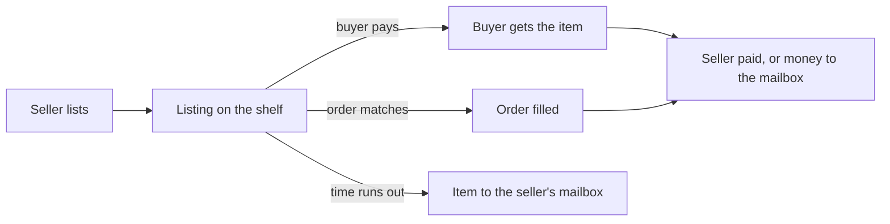

## Listings

A listing is an item on the shelf. It is one of two kinds:

| Kind | Sold |
|---|---|
| Fixed price | To the first buyer who pays the price. A retail listing lets buyers take part of the stack |
| Auction | To whoever bids the most when its time runs out. Never sold in parts |

Every listing stands for a time: `house.listing.default-duration` (2d) unless the seller names one, at most
`maximum-duration` (7d). Its category is decided once, when it is written.

## Orders

A buy order is the other side: a player names an item, an amount and a price, and the house holds their money until a
listing fills it. A new listing at or below an order's price sells into the best paying order at once.

## Watches

A watch is a player waiting for an item. When it is listed, the watchers are told.

## The mailbox

Everything the house owes a player waits in their mailbox until they take it: an unsold item, an outbid refund, the
money of a sale that could not be paid straight, an item bought while away. Nothing is ever put into hands that are not
there.

## Ids

Listings, orders, mailbox rows and log lines each have an id. The windows write them into the commands they run, so a
player rarely types one; an operator reads them in `/uxmauction lookup` and the log.

## Money is never converted

Every price, bid, fee and refund of a listing stays in the currency it was listed in. The house has no exchange rate
and never invents one. A shown price is rounded up, never down.

## A closed house

`/uxmauction lock` closes the house on every server: every window still opens and nothing moves. No listing is created,
bought, cancelled or expired while it is closed.

Related: [Your first sale](first-sale.md), [Selling](../features/selling.md)
