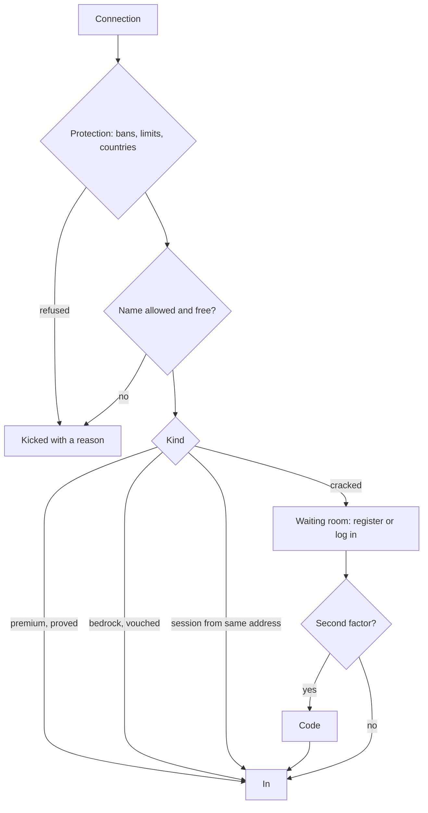

## Accounts and kinds

An account is one name with one UUID. Its kind is how it gets in:

| Kind | Gets in by |
|---|---|
| cracked | A password |
| premium | The Mojang handshake, proving the name is theirs; a backup password when Mojang is down |
| bedrock | Floodgate vouching through Xbox Live |

A name is held once, in the case it was registered in: once `Notch` has an account, `notch` is refused with a message
naming `Notch`.

## The door

## Ways in

How a session got in is its method: `password`, `registered`, `premium`, `bedrock`, `session`, `forced` (staff) or
`network` (the proxy vouched). `%uxmauth_method%` reads it, and the effects have a list per way.

## The lane

Hashing a password is slow on purpose. Hashes run on a lane of their own, `lane.threads` at a time up to
`lane.max-threads`, with `lane.queue` waiting; a login past the queue is told to try again in a moment rather than left
hanging. Nothing the door does runs on the server's main thread.

## Typed passwords stay private

A player command works for a player who has not logged in, and the password after it is kept out of the console and
the log.

## What is kept where

Accounts, sessions, address bans, factors, linked addresses, codes, the login history and a network's last servers are
all in one database, so every member of a network reads them alike. See [Database](../database/overview.md).

Related: [Your first setup](first-setup.md), [Premium names](../features/premium.md)
