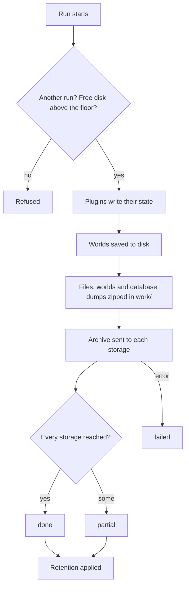

## Sets

A **set** is one named backup: what it takes and where it goes. A server wants more than one answer, such as player
data every hour and everything once a night, so sets are named, not one folder list.

## Storages

A **storage** is one place archives are kept, with its own id, type and retention. A set names the storages its
archive goes to; one archive can go to three places.

## Archives

An archive is one zip named `<set>-YYYY-MM-DD-hhmmss`, in UTC, such as `full-2026-11-03-040000`. The set comes first so
a listing groups a set's runs, and the time runs from the largest unit down so the listing is in order. Inside, every
file is listed in a manifest with its checksum, which is what `verify` reads back.

## A run

A run ends `done`, `partial`, `failed` or `refused`, and each is a row in the run history and a moment you can act on.

## Restoring

| Level | Command | Changes |
|---|---|---|
| 1. Plan | `/uxmbackup restore <id>` | Nothing. Says what an in-place restore would replace, and gives a token |
| 2. Extract | `/uxmbackup restore <id> --to <folder>` | Writes the archive into a folder beside the server; nothing live |
| 3. In place | `/uxmbackup restore <id> --token <token> --passphrase <passphrase>` | Puts the archive back; the old data is renamed aside |

All three run from the console only. See [Restoring](../features/restoring.md).

Related: [Sets and schedules](../features/sets-and-schedules.md), [Storages](../features/storages.md)
