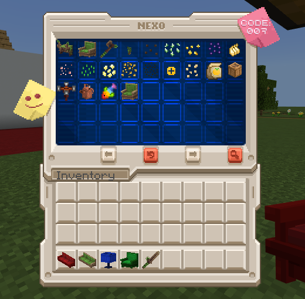

Item plugins draw a custom menu background with a tall letter of their font in the menu's title. Bedrock draws titles
its own way, so the pack draws that picture over the Bedrock screen instead, whenever a title holds the letter, and
the letter itself shows nothing.

| Setting | In | Does |
|---|---|---|
| `menu-art` | `modules` in config.conf | Turns menu pictures on |
| `art-min-height` | gui.conf | A font letter at least this many Java pixels tall is a menu picture, not an emoji. 48 |
| `menus` | gui.conf | Corrections per picture: place, size, layer, screen |
| `screens` | gui.conf | The Bedrock panels a picture is drawn into, per screen |

## The title's colour

Java draws a menu picture in its title's colour, like any letter: a title with no colour draws it in the dark grey of
container titles, a white title draws it as it was painted, and a coloured title tints it. Bedrock does the same with
the pack: each picture follows the colour code before it, so a plugin that colours its title on purpose, to tint one
picture for several menus, gets the same tint on Bedrock. A picture in a hex colour is painted in that colour by
[exact colours](text.md).

## Words over the picture

Item plugins move the title's words onto their picture with space letters, some of which move text back to the
left. Bedrock cannot move text left, so the pack lays the title out twice, as Java draws it and as Bedrock does, and
puts each word where Java puts it with clear space letters before it. Measured on Nexo's menus, a word lands within a
pixel of its place on Java.

One case stays apart: text Java draws back over earlier text, such as a second line laid over the first, stands
after it on Bedrock, since a Bedrock line only runs forward.

## Phones and tablets

Bedrock lays chests out differently on a touch screen (its pocket layout), with the slots in other places. A chest with
a picture is laid out as on a PC there too, so the picture lands on its slots. Touch players get the chest with its
picture by default; set `touch = "form"` in [menus.conf](../config/menus-conf.md) to give them a form instead, which is
easier to tap.

## Vanilla chests

A pack that draws Java's chest screen anew (`textures/gui/container/generic_54.png`, the chest of three and six rows,
and the shulker box) gets the same look on Bedrock: the panel is cut as Java draws each size and laid over Bedrock's
chest, under the items. The furnace, crafting table, anvil, enchanting table and beacon are left as Bedrock draws
them, since Bedrock places their slots differently from Java. See [Vanilla looks](pack.md#vanilla-looks).

## Placing a picture

Where a picture sits is worked out from the font: its left edge at the panel's left edge, its top from the font's
ascent. When it sits wrong:

| Way | How |
|---|---|
| Measure | `/uxmbedrock gui measure`, then open the menu as a Java player. The place is read from the title's spaces and written to gui.conf, and the pack is built again |
| Preview | Move and size it in the [preview page](preview.md), then save |
| By hand | Write `x`, `y`, `width`, `height`, `layer` or `screen` under the picture's key in gui.conf, then `/uxmbedrock reload` and `/uxmbedrock pack build` |

`/uxmbedrock gui list` lists every picture's key and place. `/uxmbedrock menus report` lists the menus Bedrock
players opened since the start, how each reached them and whether it carries a picture.

Each picture is drawn at its own size and resolution; the `width`, `height`, `x` and `y` corrections in gui.conf are
the only scaling there is.
