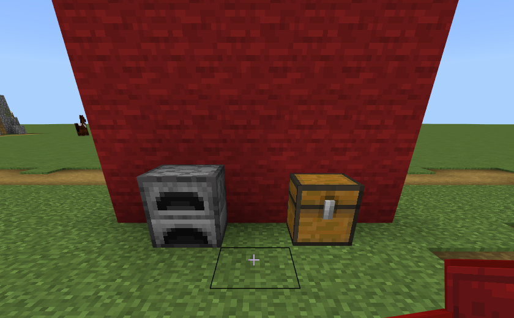
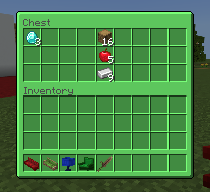

## Sources

| Source | Found at |
|---|---|
| Nexo | `plugins/Nexo/pack/pack.zip` |
| ItemsAdder | `plugins/ItemsAdder/output/generated.zip` or `output/` |
| Oraxen | `plugins/Oraxen/pack/pack.zip` |
| CraftEngine | `plugins/CraftEngine/generated/resource_pack.zip` or the folder, written the first time CraftEngine generates its pack (`/ce reload all`) |
| BetterHud | `plugins/BetterHud/build.zip` or `build/` |
| MythicHUD | `plugins/MythicHUD/built-pack/`, `generated.zip` or `pack/` |
| HappyHUD | `plugins/HappyHUD/pack.zip` or `pack/` |
| CustomNameplates, CustomFishing | `plugins/<plugin>/ResourcePack` |
| LuxDialogues | `plugins/LuxDialogues/Output/LuxDialogues.zip` or the folder |
| server.properties | The pack `resource-pack` names, fetched when `sources.server-properties` is on (up to 512 MB) |
| Your own | Every zip or folder in `sources.extra` of [pack.conf](../config/pack-conf.md) |

Only the packs these plugins have built are read, never their configuration, and only while the plugin runs: a plugin
taken off the server leaves its built pack behind, which Java players no longer get, so it is not read either. A pack
listed in `sources.extra` is read whatever wrote it. A plugin that protects its pack is named in
`/uxmbedrock pack report` with the setting to change. ItemsAdder 5 ships with its pack obfuscated: set `zip_entries`,
`zip_archive`, `png` and `short_texture_references` under `resource_pack.obfuscation` to `false`, then `/iazip`.

## What becomes what

| Java | Bedrock |
|---|---|
| Item models, item model definitions, old custom model data | Custom items Geyser registers, with icons; 3D models as geometry and attachables |
| Item models with a dye tint | Dyeable custom items: the icon and the model in the hand show the item's dye |
| Armour and elytra equipment | Attachables on the player |
| Leather armour a core shader draws (animated, emissive armour sets) | Attachables with the shader's frames, played at its speed |
| Bows, crossbows, fishing rods and bundles with their states | The same states: a bow drawn back, a cast rod, a filled bundle |
| Blocks with custom states | Custom blocks Geyser registers, broken at their host block's speed; animated textures as flipbooks |
| Custom stairs, slabs, doors and trapdoors | Custom blocks in every state, turned as Java turns them |
| Locator bar icons | The same icons on Bedrock's locator bar |
| Sounds | Bedrock sounds, re-encoded smaller with ffmpeg when it is installed |
| Fonts | Glyph pages and menu pictures |
| Language files | Geyser's locale overrides, so items keep their names |
| Custom heads | Heads Geyser registers by their skin |
| Vanilla textures, sounds and the chest screen a pack draws anew | The same on Bedrock, under Bedrock's names; see [Vanilla looks](#vanilla-looks) |

A Bedrock block draws only from 0.875 blocks below to 1.875 blocks above its corner, at most 1.875 blocks long along
any axis. A block model reaching further, such as a plant two blocks high, is cut to that room: along y the part below
the block goes first, where a plant stands in the ground, then the top; along x and z the side reaching further out.
Each cut face keeps its texture where it was. A block state Java draws with nothing (CraftEngine's `block/empty`) is a
clear block.

Geyser needs the vanilla item under each custom item. It is read from the packs, learned the first time a player
holds, picks up, places or sees an item with that model, or written in [items.conf](../config/items-conf.md).
`/uxmbedrock items unknown` lists the ones still missing.

## Vanilla looks

A pack may also draw the game's own things anew: a red stone, a louder door, a chest of another colour. Bedrock names
most of them differently, so the build carries each one to the name Bedrock uses:

| Java | Bedrock |
|---|---|
| Block and item textures | The texture Bedrock draws for the same thing, found by matching every Java texture with every Bedrock one pixel by pixel; 1720 of them are known, the rest go by their name |
| Animated block textures | Flipbooks, as Bedrock animates its own |
| Sound files | The same file, where Bedrock keeps it at the same path |
| Sound events marked `replace: true` | Bedrock's matching event, which then plays only the pack's sounds |
| The chest screen (`generic_54`, three and six rows) and the shulker box | Laid over Bedrock's chest, under the items; see [Menu pictures](menu-art.md#vanilla-chests) |

The report counts them: `Vanilla looks the packs draw anew, carried: 12 textures, 3 sounds, 2 screens`.

## Size

A build keeps one copy of each picture that is the same byte for byte, such as an item and its dyed twin, and every
file of the pack names that copy. Numbers are written to six decimals, since Bedrock reads them as 32-bit floats. On
a server with Nexo and ModelEngine this took the main pack from 2.85 MB to 2.46 MB. The [pack host](../config/geyser-conf.md#pack-host)
makes the download itself much faster.

## Past builds

The cache keeps the last eight builds. When a build goes wrong, give players an earlier one:

| Command | Does |
|---|---|
| `/uxmbedrock pack builds` | Lists the kept builds, newest first, with when each was made and its size, and marks the one players get |
| `/uxmbedrock pack rollback [back]` | Gives players the build `back` builds before the newest (1 by default) from their next join, until the next build |
| `/uxmbedrock pack cache clear` | Removes every kept build but the one players get, and what a stopped server left half built |

A rollback counts as the newest build afterwards, so a second rollback goes one further back. With `auto-convert` on,
the next change to a source builds again; turn it off in [pack.conf](../config/pack-conf.md) while you fix the source.
Neither command runs while a build does.

## New items and Geyser

Geyser reads custom items, blocks, names and heads once, at its start. A build that brings new ones reaches players'
packs from their next join, but the items themselves show as their vanilla base until Geyser restarts; the console
says so once. With Geyser on the same server, `new-items-restart = "when-empty"` in [pack.conf](../config/pack-conf.md)
restarts the server as soon as nobody is online.

## The output

`plugins/uxmBedrock/output/` holds what the Geyser extension serves:

| File | Holds |
|---|---|
| `NN.mcpack` | The content packs: items, blocks, sounds, glyphs, then your merged Bedrock packs |
| `feature-<part>.mcpack` | One pack per part a player may switch off, and `feature-ui.mcpack` for everyone |
| `animated.mcpack`, `animated-light.mcpack` | Animated content, full and light |
| `items.json`, `blocks.json`, `locales/` | Geyser's mappings and names |
| `choices.json`, `skulls.json` | Each player's choices; the heads |
| `result.json`, `screen.json`, `report.txt` | The index, the menu pictures, the report |
| `../reports/menus.json` | Written by `/uxmbedrock menus report` |

A pack's version moves with its content, so a client downloads only a pack that changed. A build whose sources did
not change comes from `cache/builds/` at once.

## When it builds

| When | Builds |
|---|---|
| Start | Always, from the cache when nothing changed |
| A source changes | When `auto-convert` is on, checked every `check-every-seconds` |
| `/uxmbedrock pack build` | Now |
| A measure or a preview save | With the new place |

A pack switched off under `modules` is taken out of the build, so no player gets it.
