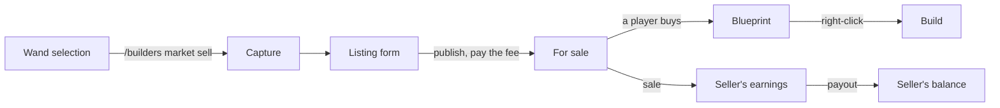

A player marks a build of theirs with the market wand and runs `/builders market sell`. The plugin
copies it into a fixed design, the player names it and sets a price, and the listing is on sale at once.
Other players find it in `/builders market`, buy a blueprint, and their builder crew builds it the way it
builds a package. The settings are in [market.yml](../../config/market-yml.md).

| Page | Covers |
|---|---|
| [Selling a build](selling.md) | The wand, the capture and what it leaves out, the listing, the fee and commission, managing listings, earnings |
| [Buying a design](buying.md) | Browsing, searching, previewing, buying, the blueprint, My designs, cancelling a market build |
| [Market moderation](moderation.md) | Reports and auto-hide, removing and revoking, restoring, bans, refunds and payouts by hand |

## From a build to a sale

The design is stored when it is listed. What the seller does to the build afterwards, demolishing it
included, changes nothing for buyers: every copy builds the stored design.

## Where the money goes

| Step | Money |
|---|---|
| Listing | The seller pays `economy.listingFee`; holders of `uxmbuilders.market.fee.exempt` pay nothing. It is not returned when the listing ends |
| Sale | The buyer pays the price. The market keeps the commission, at the rate fixed when the design was listed; the rest, the net, is owed to the seller |
| Fee and commission | Credited to `economy.commissionAccount`, a player, or destroyed when it is empty |
| Payout | The seller is paid at once or when they join, as `economy.payout` says; see [Earnings](selling.md#earnings-and-payouts) |

Prices and fees need an economy plugin through Vault. Without one, browsing still works, while listing
and buying are refused: every listing has a price nobody could pay. A seller hears it as soon as they
run `/builders market sell`, before anything is captured, fee exempt or not.

## Listing statuses

| Status | Shown as | Meaning |
|---|---|---|
| `ACTIVE` | For sale | In the market; the only status that sells |
| `PAUSED` | Paused | Taken off sale by its seller for now |
| `SOLD_OUT` | Sold out | Every limited copy is sold; copies never come back |
| `HIDDEN` | Under review | Hidden by reports or a seller ban until a moderator decides; only its seller still sees it |
| `REMOVED` | Removed | Taken down by a moderator |
| `DELETED` | Withdrawn | Withdrawn by its seller for good |

Every listing has a six-character code such as `7KQ2MX`, used by every market command. Codes ignore
case and dashes, and read `I` and `L` as `1` and `O` as `0`, so a code copied by hand still works.
Buyers keep what they bought whatever happens to the listing, unless a moderator revokes it.

## Turning it off

`enabled: false` in `market.yml` closes the market: nothing can be captured, listed or bought, and the
menus say so. Designs already bought stay buildable, `/builders market designs` keeps working, and
sellers are still paid what they are owed.

## Several servers

On a [shared database](../../config/database.md#several-servers-on-one-database) every server sells
from the same market.

| Shared | How |
|---|---|
| Listings | Each server reads the others' changes every `cache.syncSeconds` |
| The last copy | Decided by the database: two buyers on two servers cannot both get it; the one who loses is refunded and told it sold out |
| Sales, decisions | A seller playing on another server hears of a sale within 30 seconds; one who is offline hears of it on joining any server |
| Earnings | Paid on whichever server the seller is on, never twice |

## Notes

- The market's menus are `menu/market-*.yml`; see [Messages and menus](../../config/messages-and-menus.md).
  Bedrock players get six of them as lists of buttons, worded by `menu/bedrock/market-*.yml`; see
  [Bedrock forms](../../config/messages-and-menus.md#bedrock-forms).
- A player's listings, sales, earnings and designs are [placeholders](../../placeholders.md#market) for
  scoreboards.
- Category names in `market.yml` follow the [language](../languages.md) like the rest of the texts.
- The market writes listings, sales, payouts and refunds to the audit table when `logging.audit` is on.

Related: [Commands](../../commands.md#market), [Permissions](../../permissions.md#market), [market.yml](../../config/market-yml.md)
