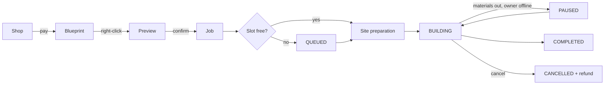

## Package

A schematic on sale, defined in `packages.yml`. It names the `.schem` file, a price, a shop category,
an icon and optional rules: a permission, a cooldown, a minimum builder level, a build order.

```yaml
packages:
  house_oak:
    display: "<white>Small Oak House</white>"
    category: houses
    schematic: house_oak.schem
    icon: OAK_PLANKS
    price: 1500
```

Every package gets a generated permission, `uxmbuilders.package.<id>`, used when its `permission` is
set to that node.

## Blueprint

The item the shop hands out after payment. It is a paper item by default, carries the package id in
its persistent data, and is marked **prepaid**: placing it never charges again. A renamed paper is not a
blueprint; the plugin reads the data, not the name.

`/builders admin give` hands out free blueprints for events and crates.

## Builder

The crew that builds a package, defined in `builders.yml`. A builder has levels, and each level sets:

| Stat | Effect |
|---|---|
| `blocksPerSecond` | How fast the job places blocks, and how fast the NPC moves |
| `efficiency` | The chance a block costs no material, from `0.00` to `1.00` |
| `price` | What the next level costs to buy |

A player owns one or more builders and has one selected. The selected builder is the one a new build
uses, and a running build keeps the builder and level it started with.

## Job

One build in progress. It moves through these states:

| State | Meaning |
|---|---|
| `QUEUED` | Waiting for a free build slot (`performance.maxConcurrentJobs`) |
| `BUILDING` | Placing blocks |
| `PAUSED` | Stopped by the owner, by missing materials, an offline owner, an unloaded world, or a restart |
| `COMPLETED` | Every block is in place |
| `CANCELLED` | Ended early, with a refund decided by the reason |

A job remembers its order of blocks, so a job paused for a week resumes at the exact block it stopped at.

## Preview

Holding a blueprint and right-clicking opens the preview: the whole structure drawn in the player's own
client as fake blocks, plus a particle outline. Nothing is placed and no entity spawns. The outline is
green where the build is allowed and red where it is not. See [Preview](../features/preview.md).

## Warehouse

An optional per-player store of materials, off by default (`materials.enabled`). When it is on, each
placed block takes one matching item from the owner's warehouse, and a build with nothing left to take
pauses until it is restocked. See [Warehouse](../features/warehouse.md).

## How they fit together


