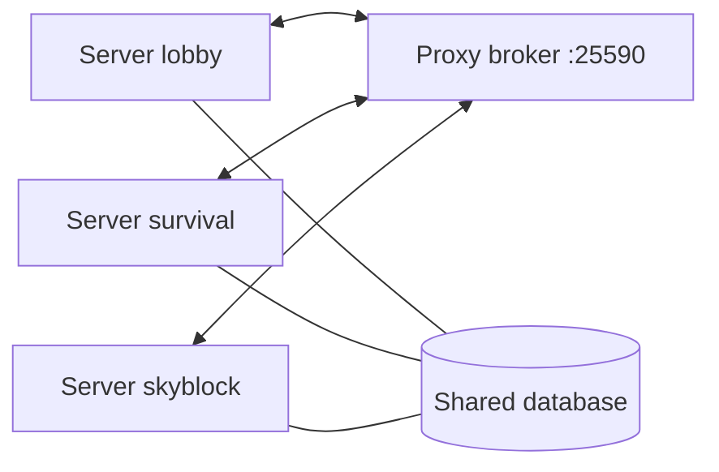

Module: `network`. With the proxy plugin, every server of a Velocity network is one chat: network channels, private
messages, mail notices, staff lines, deletes, presence, the staff list and friend locations reach every server.

## Setting it up

1. Give every server one shared MySQL, MariaDB or PostgreSQL database in `storage`, and a `server-name` equal to its
   name in `velocity.toml`, in lower case.
2. Put `uxmChat-Velocity-<version>.jar` in the proxy's `plugins/` and start it once. It writes
   `plugins/uxmchat/secrets.conf` with one secret per server. Never put that file in git.
3. On each server set `network.mode = "direct"`, `network.host` and `network.port` to the proxy's broker, and
   `network.secret` to that server's line from `secrets.conf`. Restart.
4. For network join, switch and quit lines, set `network.enabled = true` in `modules/events/events.conf` on every
   server.
5. Run the same uxmChat version on every server and the proxy: what they send each other changes between versions,
   so update them together.

## Modes

| `network.mode` | How |
|---|---|
| `none` | This server is alone |
| `direct` | One connection to the proxy plugin's broker. Works with nobody online |
| `redis` | Through a Redis server |

**Redis.** Set `network.mode = "redis"` and `network.redis-uri` on every server and in the proxy's
`plugins/uxmchat/config.conf`; the proxy joins Redis like a server and needs no secrets. Put a password in the address
as `redis://:pass@host:6379`. Redis has no per-server secret, so keep it closed to anything but the network.

## The proxy's config.conf

| Key | Default | Meaning |
|---|---|---|
| `network.mode` | `direct` | `direct` or `redis`, the same as on every server |
| `network.host` | `127.0.0.1` | Where the broker listens. `127.0.0.1` only takes servers on this machine; use an address the servers reach, or `0.0.0.0`, and keep the port closed to the internet |
| `network.port` | `25590` | The port each server's `network.port` names |
| `network.redis-uri` | `redis://127.0.0.1:6379` | For `redis` |

## The server keys

| Key | Default | Meaning |
|---|---|---|
| `server-name` | `server` | This server's id on the network, in the chat log and the staff list |
| `network.mode` | `none` | `none`, `direct` or `redis` |
| `network.host`, `port` | `127.0.0.1`, `25590` | The proxy's broker |
| `network.secret` | empty | This server's line from the proxy's `secrets.conf` |
| `network.redis-uri` | `redis://127.0.0.1:6379` | For `redis` |
| `network.proxy-online-mode` | `false` | The proxy runs in online mode while this server runs offline behind it; then every player counts as a premium account |

`modules.network = false` keeps a server alone whatever `network.mode` says. `storage.local-only = true` keeps one
server's rows in its own SQLite file; see [Database](../database/overview.md#keeping-one-server-apart).

## What scope means

A channel with `scope = "network"` reaches every server; `scope = "server"` stays. Local and world channels are always
of one server. `%uxmchat_online%` counts the network and `%uxmchat_server%` names the server a player is on.

Related: [config.conf](../config/config-conf.md#network), [Velocity config](../config/velocity-conf.md)
