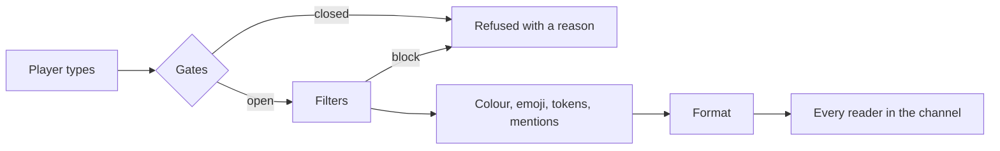

## Modules

Every feature is a switch under `modules` in [config.conf](../config/config-conf.md#modules). Every module is on
unless it is written as `false`, except `ai`, which ships off. A module turned off registers nothing: its commands
answer as unknown, its windows do not open, its placeholders read empty. `/uxmchat reload` turns one on or off without
a restart.

## The path of a line

1. **Gates.** Logged in (with an auth plugin), rules accepted, not muted, the chat not locked, the channel not locked,
   the slowmode passed, the line not too long. Each has a bypass node.
2. **Filters.** Spam, duplicate, caps, adverts, phone numbers, parrot, flood, whitespace, repeat, swearing, unicode.
   A filter blocks, censors, shadows or only tells staff, and adds points to the player's ladder.
3. **Decoration.** The player's chat colour, emoji, `[item]` and the other tokens, `@mentions`.
4. **Format.** The parts of the format the channel and the speaker's group pick.
5. **Delivery.** Every reader the channel reaches, minus those who ignore the speaker or turned public chat off.

## Channels

A channel is who hears a line. `global` reaches everyone, `local` those within a radius, `world` those in the same
world or world group. `scope = "network"` sends it to every server. A player speaks in one channel at a time and
hears every channel they joined or that joins them by itself. See [Channels](../features/channels.md).

## Formats

A format is a list of parts: a tag, a prefix, a name, the message. Each part is a template with its own hover and
click. See [Formats](../features/formats.md).

## Files and the database

Most files are read on every reload. Three hold content that lives in the database after the first start, so every
server of a network shares it and staff change it in game:

| Content | Seeded from | Changed with |
|---|---|---|
| Channels | `channels.conf` | `/chateditor channels` |
| Tags | `modules/tags/tags.conf` | `/chateditor tags` |
| Announcement bundles | `modules/announcements/announcements.conf` | `/chateditor announcements`, `/chateditor announcement` |

Each file is read again only when its table is empty. Editing it later changes nothing.

## Language keys in content

A tag, a tag category, a rarity, a channel name, a colour name, an announcement line, an event line, a bubble format or
an automatic reply may be a language key instead of text: `display = "@custom.tag.vip"` reads the `custom.tag.vip`
line of each messages file. Every reader sees it in their own language, in chat, in menus and in replies. A chat line
holding one is drawn once per language, and a line sent to another server carries every language this server has.

## Action lines

Effects, rewards, the filter ladder, custom commands and tag prices run uxmLib action lines: `[message]`, `[title]`,
`[actionbar]`, `[bossbar]`, `[sound] <name> <volume> <pitch>`, `[particle]`, `[console]`, `[player]`, `[broadcast]`,
`[give-money]` and more, each with an optional `{delay=40}` or `{chance=0.2}`. A text that starts with `@` is a line
of the messages files in the reader's language.

## Who is staff

`uxmchat.staff` makes a player staff: staff notices, the staff list, network moves. The narrower `uxmchat.staff.*`
nodes decide which notices a staff member reads. See [Permissions](../permissions/reference.md#staff).

Related: [Your first chat](first-chat.md), [config.conf](../config/config-conf.md)
