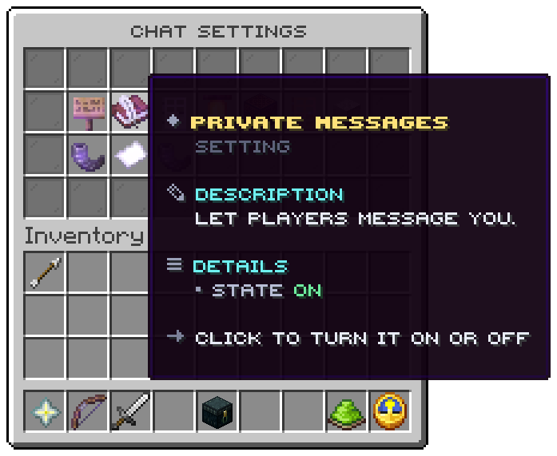

`/chat` or `/chat settings`, node `uxmchat.settings`. Four rows; the settings sit in slots 10 to 16 and 19 to 25.

A setting that is on glows. A click turns it on or off.

| Setting | On means |
|---|---|
| Public chat | Reading what players say in the channels |
| Private messages | Players may message you |
| Messages from strangers | Off means only your friends may message you |
| Mentions | Being told when somebody writes your name |
| Sounds | A sound for lines in your channels that carry one |
| Join and quit lines | Reading who comes and goes |
| Death lines | Reading how players die |
| Announcements | Reading what the server announces |
| Chat bubbles | Seeing and showing words over heads |
| Spy | Reading the copies staff tools send you; staff only |
| How a mention tells you | A click steps through sound, action bar, title, boss bar and nothing |

A setting of a module that is off is not shown. The window in the picture is the lobby's, with its own language.

Related: [Mentions and tokens](../features/mentions-and-tokens.md), [Menu files](../config/menu-files.md)
