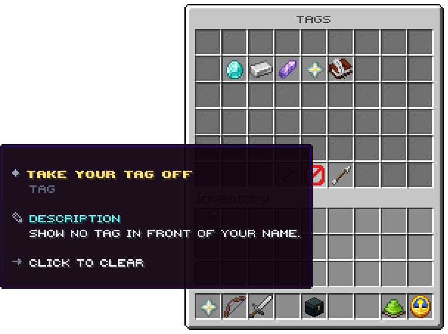

## The categories

`/tag`, node `uxmchat.tag`. Six rows; the categories sit in slots 10 to 16, 19 to 25, 28 to 34 and 37 to 43, each
with its icon and how many of its tags you hold. A category whose `permission` you lack is not shown.

| Slot | Click |
|---|---|
| A category | Opens its tags |
| 49, a barrier | Takes your tag off |
| 48, 50 | The page |

The picture is the lobby's, whose categories differ from the shipped ones.

## A category

The tags of one category, in the same slots, pinned ones first. A tag shows its rarity, its price when it has one,
and its state: `worn`, `held`, `for sale`, `locked` or `waiting for staff`. The worn tag glows.

| Click | Does |
|---|---|
| Left | Wears a held tag, takes off the worn one, or buys one for sale |
| Right | Pins the tag to the top of its category, or unpins it |
| 49, a feather | Back to the categories |

A tag with `hide-when-locked` is not shown to players who do not hold it.

Related: [Tags](../features/tags.md)
