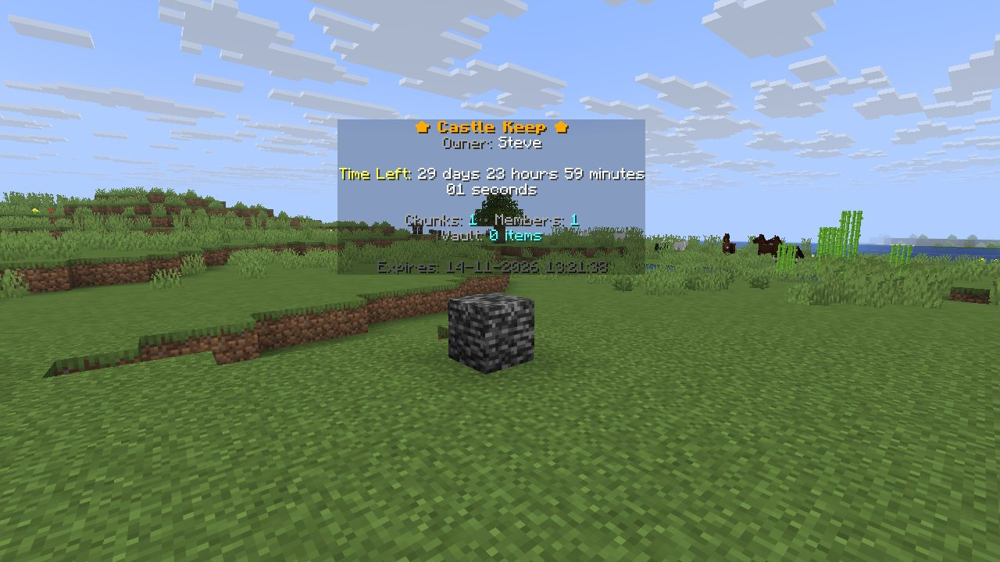

uxmClaims protects land in whole chunks. A player stands on a chunk, types `/claim`, and that 16 by 16
column, from the bottom of the world to the build limit, becomes a claim. Everything after that decides
who else may do what inside it.

It needs Java 21 and Minecraft 1.19.4 or newer on Spigot, Paper or Purpur, or Folia 1.21 or newer with
the Folia build. [Installation](installation.md) has the details.

## What a claim is

| Piece | What it means |
|---|---|
| **Chunks** | The land: one main chunk and any number of chunks connected to it. |
| **Owner** | One player. Holds every role permission, and is the only player who may change flags, roles and member overrides, transfer the claim or delete it. |
| **Members** | Players who accepted an invite. Their role decides what they may do, with per-member overrides on top. |
| **Roles** | Named sets of role permissions: `Owner`, `Member`, `Default` (everyone who is not a member) and any you create. |
| **Flags** | Rules about the world inside the claim: explosions, fire, fluids, growth, mob spawning, PvP. They apply to everyone, the owner included. |
| **Bans** | Players who hold no permission in the claim and are pushed out of it. |
| **Claim block** | A block set where the claim was made, with a hologram above it. Right-clicking it opens the claim menu. |
| **Time** | A claim lives for 30 days by default and is deleted when the time runs out, unless someone extends it or you turn expiry off. |

A role permission answers "may this player break blocks here?". A flag answers "may a creeper break
blocks here?". [How protection works](../protection/overview.md) shows how the two combine.

## What comes with it

| Area | What you get |
|---|---|
| Menus | 28 configurable menus; every operation works without a command |
| Text input | Names and confirmations in Java dialog screens on Minecraft 1.21.6 and newer, with an anvil or chat prompt as the fallback ([Menu files](../config/menus.md)) |
| Bedrock | Native forms for players who join through Geyser or Floodgate ([Bedrock menus](../menus/bedrock.md)) |
| Languages | Every shipped text in English, Turkish, Spanish, Brazilian Portuguese, German, French, Russian or Polish ([Languages](../config/languages.md)) |
| Protection | 32 flags and 48 role permissions |
| Members | Custom roles with priorities, per-member allow and deny overrides, invites and bans |
| Warps | Public or private teleport points, with an optional cost and warmup |
| Vault | One shared storage inventory per claim |
| Chat | Claim chat between members |
| Borders | Outlines drawn with display entities or particles |
| Web maps | Claims drawn on Dynmap, BlueMap, Pl3xMap or squaremap |
| Discord | Webhooks on claim events |
| Database | SQLite, MySQL or PostgreSQL |

Players never need to learn a command beyond `/claim`. The command tables exist for staff, the console
and players who prefer typing.

## Where to go next

| You want | Page |
|---|---|
| Get it running | [Installation](installation.md) |
| Understand chunks, roles, flags and claim time | [Concepts](concepts.md) |
| Walk a player through their first claim | [Your first claim](first-claim.md) |
| The full command tree | [Commands](../commands/index.md) |
| Decide what members and visitors may do | [Role permissions](../protection/permissions.md) |
| Decide what the world may do | [Flags](../protection/flags.md) |
