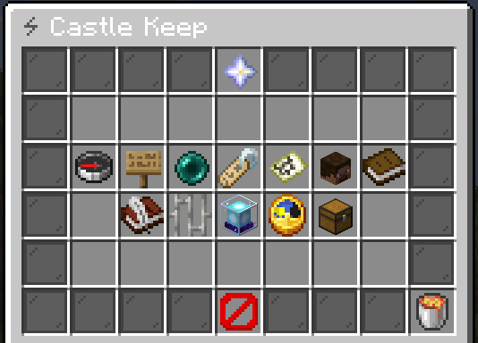
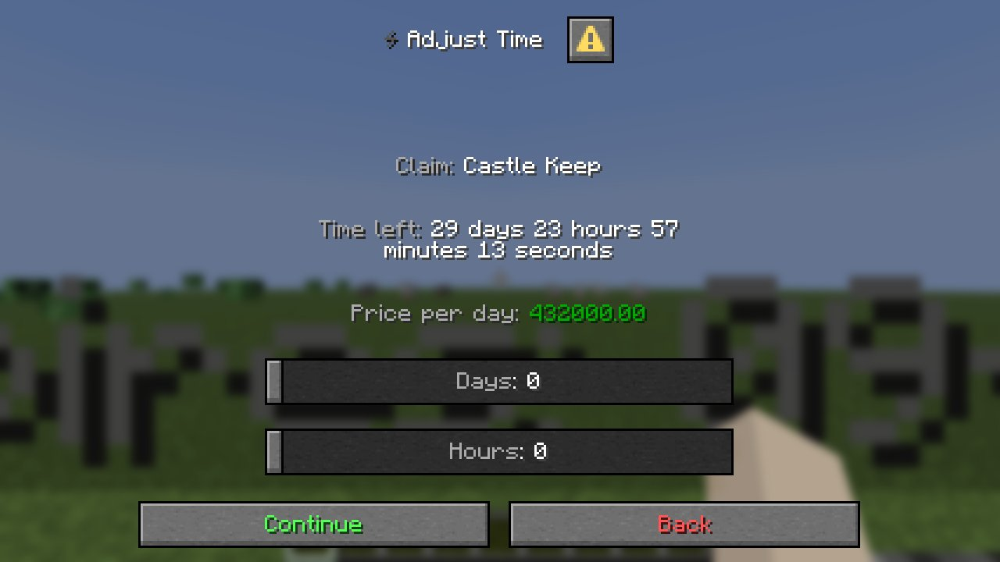

The main screen for a claim you belong to. Opened by `/claim` while standing in it, or by clicking the
claim in your claims list.

Layout: `menu/claim_main.yml`, six rows, titled with the claim's name.

| Button | Key | What it does |
|---|---|---|
| **Spawn point** | `teleport` | Click to teleport, shift-click to set the spawn where you stand |
| **Flags** | `changeFlag` | Opens the [flags screen](flags.md) |
| **Rename** | `changeName` | Asks for a new name, through the [text input](overview.md#typing-text) set in `claim_rename.yml` |
| **Chunk map** | `claimMap` | Opens the [chunk map](claim-map.md) |
| **Members** | `memberList` | Opens the [member list](members-roles.md) |
| **Roles** | `roleList` | Opens the [role list](members-roles.md#the-role-list) |
| **Invitations** | `inviteList` | Opens [pending invitations](invitations.md) |
| **Banned players** | `banList` | Opens the [ban list](bans.md) |
| **Warps** | `warpList` | Opens the [warp list](warps.md) |
| **Vault** | `claimVault` | Opens the [shared vault](vault.md) |
| **Claim block** | `claimBlock` | Places, removes or restyles the claim block |
| **Time** | `addTime` | Extends the claim's lifetime |
| **Delete** | `delete` | Deletes the claim, after confirmation |
| **Back** | `back` | Returns to your claims list |

## What each button needs

Every button is shown to every member. The action behind it checks the
[role permission](../protection/permissions.md) and the [ability node](../permissions/abilities.md),
and refuses with a message if either is missing. Players with `uxmclaims.admin` pass both role checks
and owner checks.

| Action | Role permission | Ability node |
|---|---|---|
| Set spawn | `MANAGE_RELOCATE` | `uxmclaims.ability.claim.relocate` |
| Rename | `MANAGE_RENAME` | `uxmclaims.ability.claim.rename` |
| Change a flag | Owner only | `uxmclaims.ability.claim.flag.<flag>` |
| Add or remove chunks | `MANAGE_CHUNKS` | `uxmclaims.ability.chunk.extend` / `.shrink` |
| Invite or revoke | `MANAGE_INVITES` | `uxmclaims.ability.member.invite` / `.revoke` |
| Kick, ban or unban | `MANAGE_BANS` | `uxmclaims.ability.member.kick` / `.ban` / `.unban` |
| Change roles or overrides | Owner only | see [Members and roles](members-roles.md) |
| Warps | `MANAGE_WARPS` | `uxmclaims.ability.warp.*` |
| Vault | `MANAGE_VAULT` | `uxmclaims.ability.vault.access` |
| Claim block | `MANAGE_BLOCK` | `uxmclaims.ability.block.place` / `.destroy` / `.change` |
| Time | `MANAGE_TIME` | `uxmclaims.ability.claim.reschedule` |
| Delete | Owner only | `uxmclaims.ability.claim.delete` |

## Time

`menu/claim_time_adjust.yml`. On Minecraft 1.21.6 or newer you pick days and hours on sliders, then
confirm the price in a second dialog. Elsewhere the chest opens: `+` and `-` buttons for a second, a
minute, an hour and a day, and an emerald showing the total and the cost. Click the emerald to pay.

The price is `uxmclaims.cost.time` **per second, per chunk** of the claim, defaulting to `5.0`. A week
on a one-chunk claim is 604 800 seconds, so at the shipped price that is three million of your
currency. Set the cost node before you let players near the button. The total remaining time cannot
pass the owner's `uxmclaims.limit.time` (30 days by default). With `claimSettings.expireMode` off,
claims do not expire and paying for time is refused.

## Claim block

`menu/claim_block.yml`:

| Button | Key | Does |
|---|---|---|
| Place | `placeBlock` | Places the block near where you stand |
| Remove | `destroyBlock` | Removes the block from the world |
| Change style | `changeType` | Opens `claim_block_change.yml` |
| Reset style | `resetType` | Goes back to `claimSettings.defaultBlock` |

`claim_block_change.yml` lists every style in the `blocks` section of `config.yml`, drawn with each
style's `icon`. Picking a style whose `permission` you lack is refused. The block must sit inside the
main chunk, and it carries the hologram.
