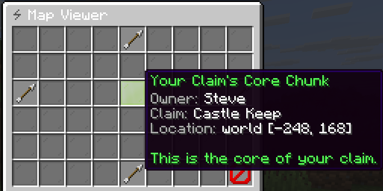

`menu/claim_map.yml`, opened from claim management or by `/claim chunk view`.

A 9 by 6 grid of glass panes, centred on your claim's main chunk. Each pane is one chunk, and the item
key it uses says who owns it. The arrows (`left`, `right`, `up`, `down`) move the grid one chunk at a
time.

| Key | Shipped pane | Meaning |
|---|---|---|
| `mainClaim` | Lime | Your claim's main chunk, holding the claim block, hologram and spawn |
| `subClaim` | Green | Your claim's other chunks |
| `allyMainClaim` | Light blue | The main chunk of another claim you are a member of |
| `allySubClaim` | Blue | Other chunks of a claim you are a member of |
| `enemyClaim` | Red | Someone else's claim |
| `region` | Red | A protected [WorldGuard](../integrations/worldguard.md) region, or a chunk in a world listed in `generalSettings.disabledWorlds` |
| `wilderness` | Gray | Unclaimed land |

## Clicking a chunk

| Chunk | Left click | Right click |
|---|---|---|
| Wilderness | Buys it for this claim | Shows its border in the world |
| Your claim | Removes it, after confirmation | Shows the claim's border |
| Any other | Tells you whose it is | Tells you whose it is |

## Rules the map enforces

| Rule | Refusal |
|---|---|
| A new chunk must touch the claim | `errorChunkNotConnected` |
| A chunk holding the claim together cannot be removed | `errorChunkBreaksConnectivity` |
| The main chunk cannot be removed; delete the claim instead | `errorMainChunkRemove` |
| Other players' land must be `claimSettings.minDistance` chunks away (default `2`) | `errorClaimTooClose` |
| Region chunks and chunks in `disabledWorlds` cannot be claimed | `errorNotClaimableArea` |

Changing chunks needs `MANAGE_CHUNKS` and the `uxmclaims.ability.chunk.extend` or `.shrink` node.

## Costs and limits

| | Node | Default |
|---|---|---|
| Price per chunk | `uxmclaims.cost.chunk.<n>.<price>` | `25.0` |
| Chunks per claim | `uxmclaims.limit.chunk.<n>` | `10`, stacking |

The limit counts the chunks of this claim against the owner's limit, and the player who clicks pays.
See [Limits and costs](../permissions/limits.md).

<Callout type="tip" title="The map shows what you cannot see">

`/claim showborders` draws borders in the world, but only around you. The map also shows chunks out of
sight, which is what you want before deciding where to expand.

</Callout>
