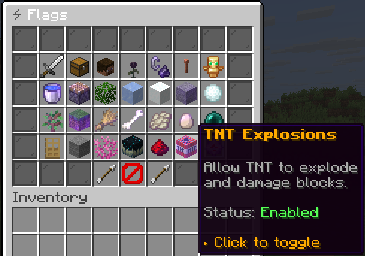

`menu/claim_flags.yml`, opened from claim management.

Every one of the 32 [flags](../protection/flags.md) appears as an item showing its current state, over
two pages. Clicking toggles it, and an active flag glows.

A flag being **on** means the thing is permitted. Turning `FIRE_SPREAD` off stops fire spreading;
turning it on lets it spread again.

## Who can toggle

Only the claim owner, or a player with `uxmclaims.admin`. Each flag also needs its own ability node,
`uxmclaims.ability.claim.flag.<flag>` (for example `…flag.keep_inventory`), or `…flag.*` for all of
them. Flags you may not change are shown but refuse on click.

The per-flag nodes let you decide which flags owners tune themselves. Grant `…flag.keep_inventory` and
`…flag.mob_spawning`, and `PVP` stays a server decision.

## The order on screen

The items fill `itemSlots` in this order, not by any `slot` key:

| Group | Flags |
|---|---|
| Security and damage | `PVP`, `KEEP_INVENTORY`, `CREEPER_DAMAGE`, `WITHER_DAMAGE`, `FIRE_SPREAD`, `LIGHTNING_DAMAGE`, `MOB_GRIEFING` |
| World mechanics | `FLUID_FLOW`, `PISTON_PUSH`, `LEAF_DECAY`, `ICE_MELT`, `BLOCK_FADE`, `BLOCK_FORM`, `ENTITY_BLOCK_FORM`, `STRUCTURE_GROW`, `NATURE_SPREAD` |
| Spawning | `SPAWN_ANIMALS`, `SPAWN_MONSTERS`, `SPAWN_PHANTOMS`, `MOB_SPAWNING` |
| Mob behaviour | `ENDERMAN_PICKUP`, `ZOMBIE_DOOR_BREAK`, `SILVERFISH_INFEST` |
| Blocks | `CORAL_FADE`, `SCULK_SPREAD`, `REDSTONE` |
| Explosions | `TNT_EXPLOSIONS`, `END_CRYSTAL_DAMAGE`, `BED_EXPLOSION`, `FIREBALL_DAMAGE`, `DRAGON_DAMAGE`, `RESPAWN_ANCHOR_EXPLOSION` |

Each flag's item is keyed by its name in camelCase, such as `fireSpread`. The state text comes from
`statusActive` and `statusPassive` in `messages.yml`.

## Two that surprise people

- **`MOB_SPAWNING` is a master switch.** Off, nothing spawns naturally regardless of the three
  specific spawn flags. A player turning it off to stop creepers also stops their cow farm.
- **`REDSTONE` off breaks farms.** It stops redstone current entirely, which is heavier than most
  players expect from the name.
