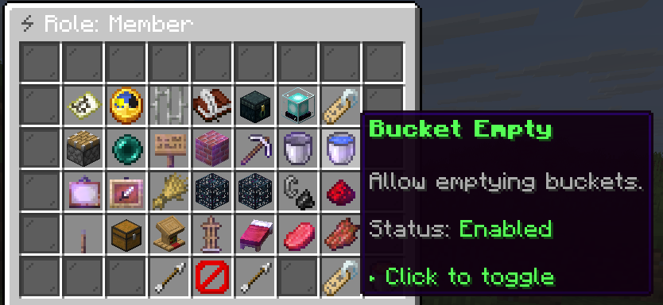

## The member list

`menu/claim_member_list.yml`, opened from claim management. Paginated, one head per member, showing
their role and join date.

| Click | Does |
|---|---|
| Click | Opens member management |
| Shift + left click | Promotes to the next role up, never to `Owner` |
| Shift + right click | Demotes to the next role down, never to `Default` |
| **Add member** (`addMember`) | Asks for a player name and sends an [invitation](invitations.md) |

## Managing one member

`menu/claim_member_manage.yml`. Every one of the 48 [role permissions](../protection/permissions.md)
is listed with the member's effective state, and an allowed one glows. Clicking writes an override on
the member:

- If the member has the permission, clicking denies it.
- If not, clicking allows it.
- An override that only repeats the role's value is removed instead.

The member carries an *allowed* set and a *denied* set, and denied is checked first, so a denial holds
even if you later promote them. The state shown is the override if there is one, otherwise the role's
value, otherwise the `Member` role's value if their role no longer exists.

| Button | Key | Does |
|---|---|---|
| Kick | `kickMember` | Removes the member, after confirmation |
| Ban | `banMember` | Bans the member, after confirmation |
| Transfer | `transferOwnership` | Makes the member the owner, after confirmation |

| Action | Who | Ability node |
|---|---|---|
| Promote or demote | Owner only | `uxmclaims.ability.member.role` |
| Override one permission | Owner only | `uxmclaims.ability.member.permissions.<permission>` |
| Kick | `MANAGE_BANS` | `uxmclaims.ability.member.kick` |
| Ban | `MANAGE_BANS` | `uxmclaims.ability.member.ban` |
| Transfer ownership | Owner only | `uxmclaims.ability.claim.transfer` |

## The role list

`menu/claim_role_list.yml`, opened by **Roles** in claim management. Every role in the claim, ordered
by priority, lowest number first: `Owner` is `0`, `Member` `1`, `Default` `2`.

| Click | Does |
|---|---|
| Click | Opens the role editor |
| Shift + left click | Raises the role's priority by one |
| Shift + right click | Lowers the role's priority by one |
| **Create** (`addRole`) | Asks for a role name, through `claim_role_create.yml` |

## The role editor

`menu/claim_role_manage.yml`. All 48 permissions with their current state; click to toggle.

| Button | Key | Does |
|---|---|---|
| Rename | `renameRole` | Asks for a new name, through `claim_role_rename.yml` |
| Delete | `deleteRole` | Deletes the role, after confirmation |

Every role action is for the owner only, and each needs its ability node:

| Action | Ability node |
|---|---|
| Create | `uxmclaims.ability.role.create` |
| Toggle a permission | `uxmclaims.ability.role.permissions.<permission>` |
| Rename | `uxmclaims.ability.role.rename` |
| Change priority | `uxmclaims.ability.role.priority` |
| Delete | `uxmclaims.ability.role.delete` |

The per-permission nodes let you keep some permissions, such as `MANAGE_VAULT`, out of the owner's
hands entirely.

## Limits

| | Node | Default |
|---|---|---|
| Members per claim | `uxmclaims.limit.member.<n>` | `50`, stacking |
| Custom roles per claim | `uxmclaims.limit.role.<n>` | `5`, MAX |

<Callout type="warning" title="Deleting a role moves its members to Member">

Members holding a deleted role fall back to the built-in `Member` role, which by default may build,
break and open every container. Move them somewhere else before deleting a restrictive role.

</Callout>
