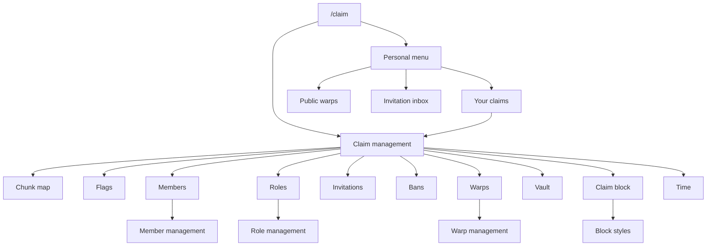
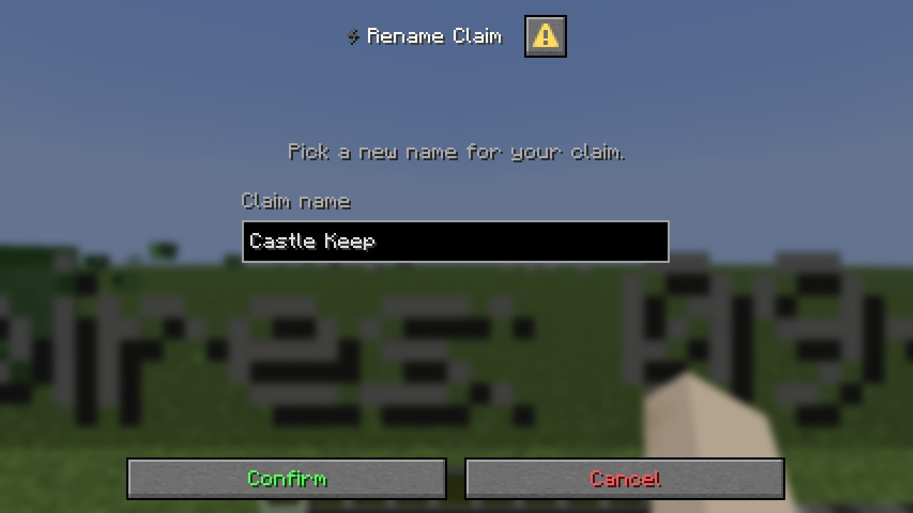

uxmClaims is GUI-first. Nearly every operation in the [command tree](../commands/) has a screen, so you
can tell players one thing: type `/claim`.

## The map

## What opens what

| Command | Screen |
|---|---|
| `/claim` in a claim you belong to | Claim management |
| `/claim` in someone else's claim | Personal menu |
| `/claim` in the wilderness | Claims or extends land when `generalSettings.smartCommand` is `true` (the default), otherwise the personal menu |
| `/claim menu` | Personal menu, always |
| `/claim list` | Your claims |
| `/claim select` | Claim picker |
| `/claim warps` | Public warps |
| `/claim invites`, `/claim invite inbox` | Invitation inbox |
| `/claim chunk view` | Chunk map |
| `/claim vault` | Vault |
| `/claim admin view <player>` | That player's claims, for admins |

## Typing text

Some buttons ask for text: a claim, role or warp name, or a player to invite or ban. The plugin
picks the first screen that works for that player:

| Screen | Who gets it | How to cancel |
|---|---|---|
| Dialog, a form with a text box | Java players on Minecraft 1.21.6 or newer, on a server that supports dialogs | **Cancel** or Escape |
| Bedrock form | Players joining through Geyser or Floodgate | Close the form |
| Anvil | Everyone else, for screens set to `ANVIL` | Close the anvil |
| Chat | Everyone else, for screens set to `CHAT` | Type `cancel` |

In chat, a countdown title runs for 30 seconds and your message is not shown to other players.
`cancel` always works; `chatInputCancelWord` in [messages.yml](../config/messages-yml.md) adds a word of
your own, such as a translated one. Submitting an empty box counts as cancelling. Which screen each
file asks for is set in its `type` and `fallback` keys: see [Menu layouts](../config/menus.md#text-input).

Dialogs also replace two chest screens on 1.21.6+: the confirmation screen becomes a yes/no dialog,
and claim time is chosen with sliders.

## Conventions

- **Left click acts, shift-click does the secondary thing.** On the spawn button, click teleports and
  shift-click sets the spawn. Lore states which is which on every button that has both.
- **Destructive actions route through a confirmation screen**: `common_confirmation`. Set
  `generalSettings.confirmationEnabled: false` in config.yml to skip it.
- **Permissions are checked when you click.** Every button is shown, and the action behind it refuses
  if your [role permission](../protection/permissions.md) or ability node does not allow it.

Every screen is a file in `menu/`. See [Menu layouts](../config/menus.md) for the file format and
[Bedrock menus](bedrock.md) for players on Bedrock Edition.
