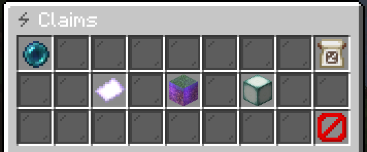

Opened by `/claim menu`, or by `/claim` inside a claim you do not belong to.

Layout: `menu/common_main.yml`.

| Button | Key | Does |
|---|---|---|
| Your claims | `myClaims` | Opens the list of claims you own or belong to |
| Claim this chunk | `buyClaim` | Creates a claim where you stand, after confirmation; the lore shows the price |
| Show borders | `showBorders` | Turns the in-world border display on or off, like `/claim showborders` |
| Invitations | `inviteInbox` | Opens your invitation inbox |
| Public warps | `publicWarps` | Opens every published warp on the server |
| Close | `closeMenu` | Closes the menu |

## Your claims

`menu/common_list.yml`, also opened by `/claim list`. Paginated, filling the slots listed in
`itemSlots`. Players with `uxmclaims.admin` see every claim on the server.

Each entry shows the claim's name, its owner and its remaining time.

| Click | Does |
|---|---|
| Click | Opens [claim management](claim-management.md) |
| Shift + left click | Selects the claim, which makes commands such as `/claim role create` work from anywhere |
| Shift + right click | Clears your selection |

The currently selected claim renders through the `…Selected` item variant, with a glint and a tick in
the name. `/claim admin view <player>` opens the same layout for another player's claims.

## Public warps

`menu/common_warp_list.yml`, also opened by `/claim warps`. Every warp set to public, from every claim.
Each item shows who created the warp through `%creator%`, the player's name, or their UUID when the
player is unknown. `%warp.createdBy%` prints the UUID.

Clicking teleports, after the `uxmclaims.delay.teleport` warmup and any
`uxmclaims.cost.warptp.public` charge. If the owning claim has the `PVP` flag on, the confirmation
screen appears first.

## Invitation inbox

`menu/common_invite_inbox.yml`, also opened by `/claim invites`. Every claim waiting for your answer:
left click accepts, right click declines.

## The picker

`menu/common_selection.yml`, opened by a bare `/claim select`. Clicking a claim selects it and closes
the menu, the same as `/claim select <name>`. The selection lasts until you select something else or
the claim goes away.
