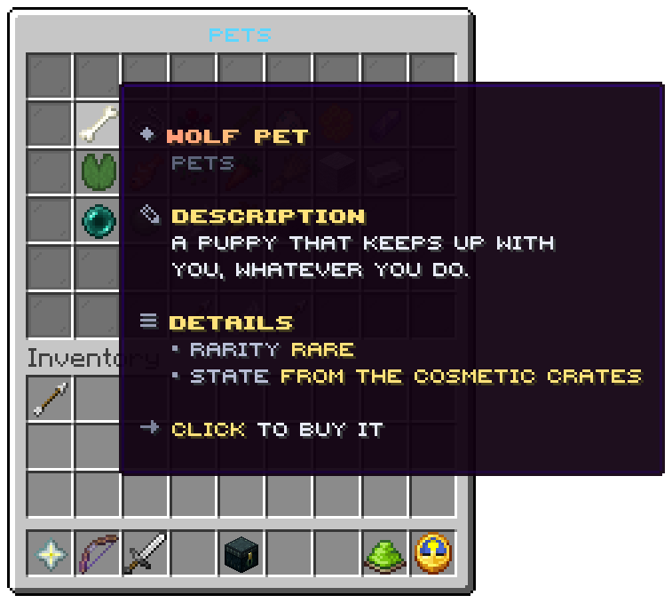

A family tile, or `/cosmetics open <family>`. Six rows; the title is the family's name.

## Slots

| Slot | Tile | Click |
|---|---|---|
| 10 to 16, 19 to 25, 28 to 34, 37 to 43 | One piece each, in file order | Wears, takes off, plays or buys, by its state |
| 22 | Grey pane, `menu.category.nothing`, only when the family has no piece | Nothing |
| 48 | Arrow | The previous page |
| 49 | Feather, `Back` | The wardrobe |
| 50 | Arrow | The next page |
| Every other slot | Grey pane | Nothing |

A worn piece glows.

## A piece

The tile is drawn from the block of its state, `menu.category.cosmetic.<state>`:

| State | Shown when | Action line |
|---|---|---|
| `worn` | It is on | `Click to take it off` |
| `owned` | The player has it | `Click to wear it` |
| `played` | The player has it and it is an emote | `Click to play it` |
| `for-sale` | Not theirs, price above 0 | `Click to buy it` |
| `not-for-sale` | Not theirs, price 0 | `This one cannot be bought` |

| Line | From |
|---|---|
| Title | The piece's name, in the family's colour |
| Crumb | The family's name |
| Description | The piece's `description`, or the family's shared sentence |
| Rarity | The rarity's word and colour |
| Price | In `economy.format`, or `Not for sale` |
| State | `Worn now`, `Yours`, `For sale` or `Not for sale` |

The screenshot is the lobby's own setup, which sells nothing and writes its own words for the state.

Related: [The wardrobe](../features/wardrobe.md), [Getting cosmetics](../features/getting-cosmetics.md)
