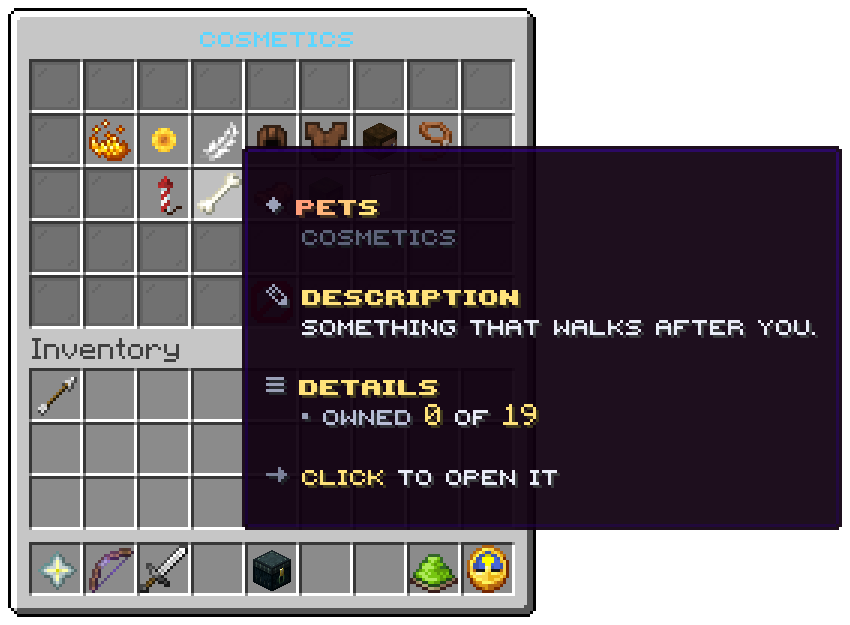

`/cosmetics`, or a right click on the opener. Five rows.

## Slots

| Slot | Tile | Click |
|---|---|---|
| 10 | Blaze powder, Trails | Opens the family |
| 11 | Sunflower, Halos | Opens the family |
| 12 | Feather, Cloaks | Opens the family |
| 13 | Leather helmet, Hats | Opens the family |
| 14 | Leather chestplate, Suits | Opens the family |
| 15 | Player head, Emotes | Opens the family |
| 16 | Lead, Balloons | Opens the family |
| 20 | Firework rocket, Gadgets | Opens the family |
| 21 | Bone, Pets | Opens the family |
| 22 | Saddle, Mounts | Opens the family |
| 23 | Zombie head, Morphs | Opens the family |
| 24 | White banner, Banners | Opens the family |
| 40 | Barrier, `Take everything off` | Takes every piece off |
| Every other slot | Grey pane | Nothing |

## A family tile

| Line | From |
|---|---|
| Title | `menu.wardrobe.<family>.title`, in the family's colour from `menu.colours.categories` |
| Crumb | `Cosmetics` |
| Description | `menu.wardrobe.<family>.description` |
| Owned | `<owned> of <total>`: pieces the player owns in the database, of the family's total. A piece held only by node is not counted |
| Action | `Click to open it` |

The mystery boxes have no tile here: they open from `/cosmetics boxes` and from stations. Add a tile with the click
`cosmetics:boxes` to put them in the wardrobe.

Related: [Family](category.md), [The wardrobe](../features/wardrobe.md)
