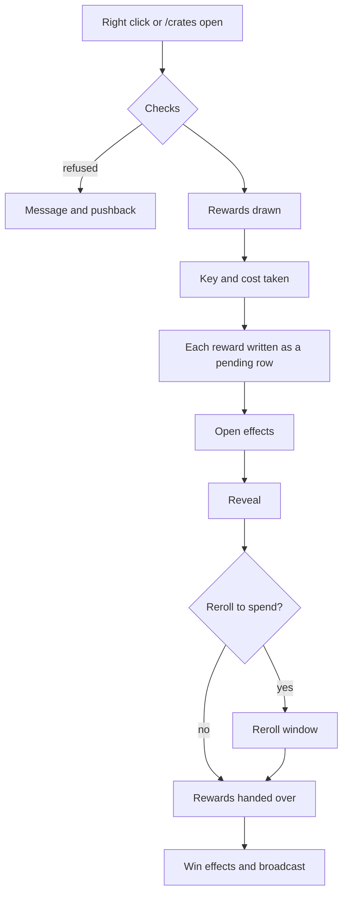

## From the click to the reward



The checks are listed on [Player commands](../commands/player.md#open). The opening is counted and the cooldown
starts when the key is taken. The rewards are written down before the reveal starts, so nothing after that point can
lose them.

## Who sees the reveal

| `visibility.mode` | Sees it |
|---|---|
| `opener` | Only the player who spent the key |
| `radius` | Everyone within `visibility.radius` blocks |
| `everyone` | Everyone in the world |

A crate without a `visibility` block reads `opening.default-visibility` (`opener`) and `opening.default-radius` (16).

## Skipping

With `opening.skippable = true`, a shift click or closing the window ends the reveal and pays out at once, after
`opening.skip-after-ms` (500). Neither changes what was won.

## Bulk opening

`/crates massopen <crate>` opens up to the crate's `bulk.cap`, else `opening.bulk-cap` (25), with no animation and one
[summary window](../menus/bulk.md) that counts each reward. Every check of a single opening holds for each.

| `bulk.announce` | Tells the server |
|---|---|
| `each` | Every win the crate would broadcast on its own |
| `once` | One broadcast naming the best win |
| `never` | Nothing |

## Pick crates

```hocon
selection { enabled = true, picks = 1, faces = 9, face-down = false }
```

The crate shows up to `faces` of its rewards, shuffled, and the player clicks `picks` of them. No weight is read and
nothing rolls; the log records each one as a choice. A reward the player cannot win is not offered. `face-down = true`
hides the faces until taken. A player who closes the window without taking anything gets the key back
(`pick.nothing-taken`).

## Pending rewards

A reward that does not fit in the inventory, or a player who logs out mid reveal, leaves a pending row:

- the player reads `pending.stored` at once;
- at every join they read `pending.on-join` with the count;
- `/crates claim` opens the [waiting rewards](../menus/pending.md), where a click takes one.

A pending reward is never purged.

## The preview

`/crates preview <crate>`, a left click on a placed crate, or a left click in the crate list. One page per group,
each reward with its weight, the reader's chance and its rarity. A player opens at most one preview per
`opening.preview-cooldown-ms` (2500), against a client that asks for windows in a loop.

Related: [Reveals](reveals.md), [opening.conf](../config/opening-conf.md), [Rerolls and milestones](rerolls-and-milestones.md)
