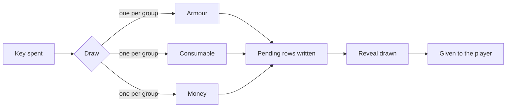

## A crate is a file

Every crate, key, reward, envoy and animation is a HOCON file whose name is its id: `crates/common.conf` is the crate
`common`. Nothing keys off a display name, so renaming a crate for players never breaks a command, a placed block or a
placeholder.

A name a player reads takes one of three shapes:

| Shape | Example | Reads |
|---|---|---|
| A line of the messages files | `name = "@content.crates.common.name"` | The reader's language, from `messages_<lang>.conf` |
| A block per language | `name { en = "Common Crate", tr = "Sıradan Kasa" }` | The reader's language, from the file itself |
| One text | `name = "Common Crate"` | The same for everyone |

The shipped files use the first, so a new language is one more messages file and no edit to any crate.

## Groups and weights

A crate holds one or more **groups**, and an opening draws exactly **one reward from each group**. One group is a flat
table. Three groups give one armour piece, one consumable and one sum of money in a single opening.

A reward's chance is its **weight** over the sum of the weights in its group. A weight is a number, never a
percentage: `60`, `30`, `9` and `1` are 60, 30, 9 and 1 percent because they add up to 100, and they would still work
if they did not.

## The effective weight

A reward the player cannot win right now weighs zero for them, and the others in the group become likelier in its
place:

- a reward whose [limit](../features/rewards.md#limits) is used up, for this player or for the server;
- a reward behind a `permission` the player lacks;
- a reward that is only ever [linked](../features/rewards.md#linked-rewards) to another.

[Rank luck](../features/rewards.md#luck) multiplies the rest. The preview shows the result for the player reading it,
and the draw rolls the same numbers. There is one function in the plugin that decides how likely a reward is.

## Keys

A key is its own file. A crate names which key it takes, how many per opening, and the kind:

| Kind | Meaning |
|---|---|
| `virtual` | A balance in the player's name, kept in the database |
| `physical` | An item in the inventory |
| `either` | Physical first, then the balance |

A crate with `amount = 0` takes no key and is paid by its `cost` lines instead.

## Decided before it is shown

An opening checks everything, takes the key and the cost, draws the rewards and writes each one as a **pending row**
with the player's name on it. Only then does the reveal start. The animation arranges faces around a result that is
already fixed, so it cannot change what is won, and a skip, a closed window or a crash still pays out.

A reward that does not fit in the inventory stays pending. The player is told at once and again at every join, and
takes it from [`/crates claim`](../menus/pending.md).

## Where a crate lives

| Shape | How it opens |
|---|---|
| `block` | A placed block: right click opens, left click previews. Placed with `/uxmcrates place` or the link tool |
| `menu` | Nothing in the world: from the `/crates` window or `/crates open <crate>` |

Every crate, of either shape, can also be opened from `/crates` and `/crates open`.

## The reveal

An animation file under `animations/` decides how a reward is shown and nothing else. A window reveal opens a chest
window; a world reveal draws display entities around the crate block as packets, for each viewer on their own. A
crate's `visibility` says who sees it: the opener, everyone within a radius, or everyone.

Related: [Your first crate](first-crate.md), [Crates](../features/crates.md), [Rewards and groups](../features/rewards.md)
