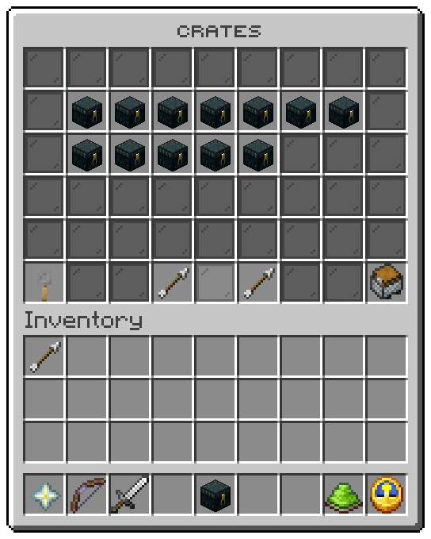

`/crates` opens six rows: a tile per crate, the player's keys and their waiting rewards.

## Slots

| Slot | Tile | Click |
|---|---|---|
| 10 to 16, 19 to 25, 28 to 34 | One crate each, in the order the files are read | Left: [preview](preview.md). Right: open it |
| 45 | Tripwire hook, `Your keys` | Opens the [keys window](keys.md) |
| 48 | Arrow, `Previous page` | Turns the page |
| 50 | Arrow, `Next page` | Turns the page |
| 53 | Chest minecart, `Waiting rewards` | Opens the [waiting rewards](pending.md) |
| Every other slot | Grey pane | Nothing |

The tile's item is the crate's block `material`, or `icon-menu` (ender chest) from the window file for a `menu` crate.
Its stack size is the number of keys the player holds for it.

## A crate

| Line | From |
|---|---|
| Title | The crate's name, in `tile-colour` (wheel place 5) |
| Crumb | `menu.crate.crumb`: `Crate` |
| Description | `menu.crate.description`, or `description-paid` for a crate that takes no key |
| Keys you hold | The keys the crate takes, held as items or a balance. Left out for a crate that takes no key |
| Next opening | The wait left, or `Ready now` |
| Action | `Right click to open.` and `Left click to look inside.`, or `You cannot open this one.` without the crate's permission |

Opening from here runs every check of [`/crates open`](../commands/player.md#open). The window closes and the reveal
starts.

Related: [Preview](preview.md), [Keys](keys.md), [Crates](../features/crates.md)
