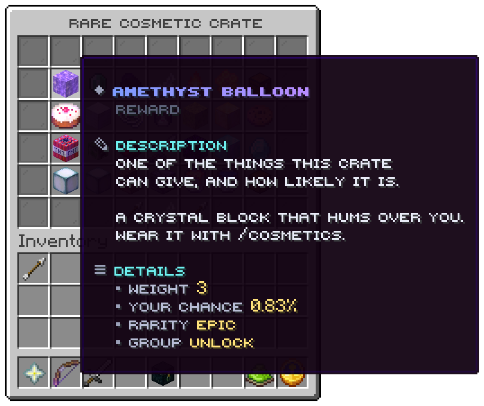

`/crates preview <crate>`, a left click on a placed crate, or a left click on a crate in the list. The title is the
crate's name. Nothing is spent.

## Slots

| Slot | Tile | Click |
|---|---|---|
| 10 to 16, 19 to 25, 28 to 34, 37 to 43 | One reward each | Nothing |
| 48 | Arrow | The previous page |
| 49 | Feather, `Back` | The [crate list](crates.md) |
| 50 | Arrow | The next page |
| Every other slot | Grey pane | Nothing |

Each group starts on a page of its own, so the rewards of one group are never mixed with another's. Within a group the
rewards are in `display.order`, then by id. The rest of a group's last page is filled with grey panes.

## A reward

| Line | From |
|---|---|
| Title | The reward's `display.name` |
| Crumb | `Reward` |
| Description | `menu.reward.description`, then the reward's own `display.lore` |
| Weight | The weight written in the file |
| Your chance | The reader's real chance, with `odds.decimals` places, after limits, permissions and luck |
| Rarity | The rarity's name |
| Group | The group's name |
| State | `Locked` without the reward's permission, `Used up` at its limit. Absent otherwise |

The item is `display.icon`, else the first item the reward gives. `glow = true` on the icon adds the glint.

With `odds.show = false` the weight and the chance are replaced by `The odds are not shown on this server.` Every
winnable reward is shown: there is no hidden pool.

A player opens at most one preview per `opening.preview-cooldown-ms`.

Related: [Rewards and groups](../features/rewards.md), [config.conf odds](../config/config-conf.md#odds)
