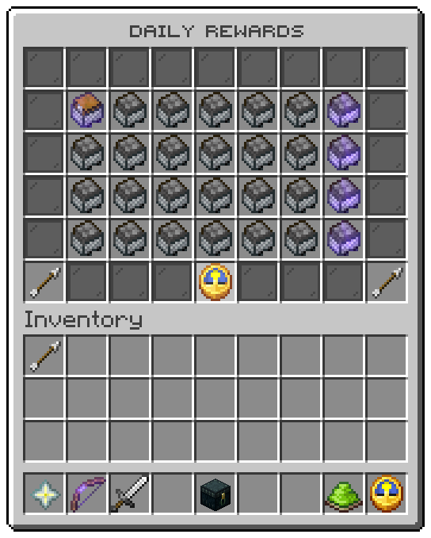
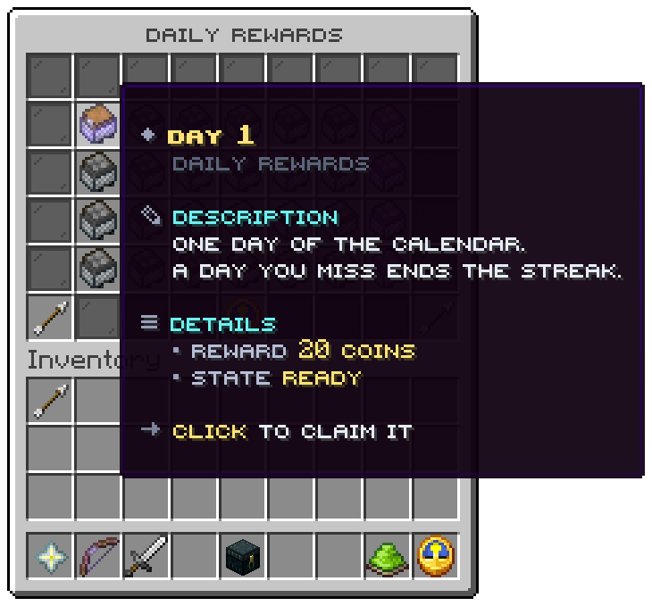

`/dailyrewards` opens the calendar: six rows, one tile per day, the streak at the bottom.



The screenshots are from a lobby with its own day files, paying coins; the tables below describe the shipped
`menus/calendar.conf` and `days/`.

## Slots

| Slot | Tile | Click |
|---|---|---|
| 10 to 16, 19 to 25, 28 to 34, 37 to 43 | One day each, 28 to a page | Left click on the ready day claims it; any other day refuses with the denied sound |
| 45 | Previous page | Turns back a page, when the calendar is longer than 28 days |
| 49 | Your streak | Nothing |
| 53 | Next page | Turns forward a page |
| Every other slot | Grey pane | Nothing |

A claim from the window answers in chat as `/dailyrewards claim` does, then draws the window again with the new
states.

## A day



| Line | From |
|---|---|
| Title | `menu.day.title`: `Day <day>`, in the colour of the day's state |
| Crumb | `menu.day.crumb`: `Daily rewards` |
| Description | `menu.day.description`: `One day of the calendar. A day you miss ends the streak.` |
| Reward | What the day gives at the viewer's rank, see below |
| State | `menu.day.state-<state>`: `Ready`, `Next up`, `Taken` or `Not yet` |
| Click line | `menu.day.action-<state>` |

## The four states

| State | Shown when | Icon (`icon-<state>`) | Title colour (`role-<state>`) | Click line |
|---|---|---|---|---|
| `claimable` | The day the player may claim now | `CHEST_MINECART`, glowing | `cta` | `Click to claim it` |
| `waiting` | The next day, while the window runs | `COMMAND_BLOCK_MINECART` | `info` | `Come back when the wait is over` |
| `claimed` | A day taken in this round | `MINECART` | `good` | `You have taken this day` |
| `locked` | Any later day, or every day after the streak ran out | `FURNACE_MINECART` | `muted` | `Come back on this day` |

### Icons

The icon of each state is set under `placeholders` at the top of `calendar.conf`. With all four set, as shipped, a
day is drawn by its state and the day file's `icon.material` is not shown. Write an empty value, such as
`icon-locked = ""`, to draw the days of that state with their own icon. `icon.model-data` and `icon.glow` of the day
file apply in every state.

## The reward line

The reward line names what the day's lines give, at the viewer's rank:

| A line | Is named as | Key |
|---|---|---|
| `[console] give %player% <item> <amount>` or `[player] give ...` | The amount and the item, in the viewer's client language | `menu.day.reward.item` |
| `[give-money] vault`, `vault-unlocked` or `treasury` | `<amount> coins` | `menu.day.reward.coins` |
| `[give-money] exp` | `<amount> experience` | `menu.day.reward.experience` |
| `[give-money] levels` | `<amount> levels` | `menu.day.reward.levels` |
| `[give-money] playerpoints` | `<amount> points` | `menu.day.reward.points` |
| `[give-money] ecobits:<currency>` | `<amount> <currency>` | `menu.day.reward.currency` |

Parts are joined with `menu.day.reward.separator`. Any other line, a title or a crate key command, is not named. For
a day whose reward needs a sentence, write a line of its own under `menu.day.rewards` in every messages file:

```hocon
menu {
  day {
    rewards {
      7 = "A rare crate key"
    }
  }
}
```

That line is shown instead of the named parts. A day that names nothing and has no line of its own shows no reward
line.

## Your streak

The clock in slot 49:

| Line | From |
|---|---|
| Title | `menu.info.title`: `Your streak` |
| Description | `menu.info.description` |
| Streak | The current streak; `0` once it has run out |
| Next reward | `Waiting for you` when a day is ready, else the time left, such as `23h 59m 41s` |
| Click line | `Click a day to claim it`, or `Come back when the time is up` |

The time is the time when the window was drawn; it does not count down while the window stays open.

Related: [Overview](overview.md), [The calendar](../rewards/calendar.md), [Menu files](../config/menu-files.md)
