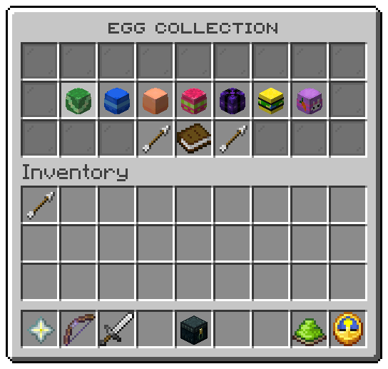
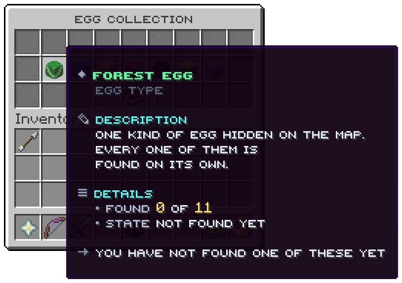

`/eggs` opens the collection: one tile per egg type with how many of its eggs the player has found, and a summary of
the whole map. File: `menus/collection.conf`.

## The slots

| Slots | Item | Shows | Click |
|---|---|---|---|
| 10 to 16, 19 to 25, 28 to 34, 37 to 43 | The type's head, glowing when complete | The type's name, *Found 3 of 11*, and the state: *Not found yet*, *Started* or *Complete* | nothing |
| 49 | Book | *Your progress*: found of the map's total, and the share in per cent | nothing |
| 48 | Arrow | Previous page | turns back |
| 50 | Arrow | Next page | turns on |

Twenty eight types fit on a page. With `menu.collection.hide-missing = true` in `config.conf`, a type the player has
not found one of is drawn as a grey dye instead of its head, so the head stays a surprise. A type whose texture is
neither a skin URL nor a base64 texture is drawn as a plain player head.

## The values

| Token | Value |
|---|---|
| `%type%`, `%type_id%` | The type's display name, and its file name |
| `%type_icon%` | The head, or the `hidden_icon` or `plain_head` of the file's `placeholders` block |
| `%type_position%` | The type's place in the list, used as the tile's colour on the wheel |
| `%type_found%`, `%type_total%` | Eggs of this type found by the viewer, and placed |
| `%type_complete%` | `true` when the viewer has found them all |
| `%type_state%`, `%type_action%` | The state and the closing line, from `menu.collection.state-*` and `action-*` |
| `%found%`, `%total%`, `%percent%` | The whole map, for the viewer. The per cent is rounded down |

Related: [Types](../hunting/types.md), [Leaderboard](leaderboard.md), [Placeholders](../placeholders/reference.md)
