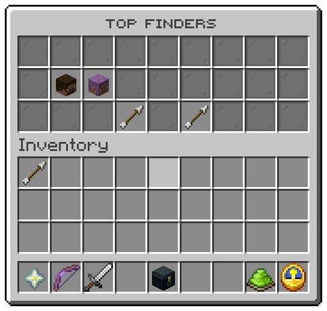

`/eggs top` with no board opens this window for a player. It ranks players by the eggs they have found, all time.
File: `menus/leaderboard.conf`.

## The slots

| Slots | Item | Shows | Click |
|---|---|---|---|
| 10 to 16 | The player's head | Name, *Rank n*, and eggs found | nothing |
| 10 | Barrier | *Nobody yet*, while nobody has found an egg | nothing |
| 21 | Arrow | Previous page | turns back |
| 23 | Arrow | Next page | turns on |

The board holds `menu.leaderboard.size` players, 10 by default; seven fit on a page and the arrows reach the rest.
The head is drawn from the player's account id, from the server's own cache. For a period other than all time, use
`/eggs top found weekly` in chat or the [placeholders](../placeholders/reference.md).

## The values

| Token | Value |
|---|---|
| `%player%`, `%player_id%` | The player's name and account id |
| `%rank%`, `%board_position%` | Their place, counted from 1 |
| `%board_found%`, `%board_total%` | Eggs they found, and eggs on the map |

| Condition | True while |
|---|---|
| `eggs:nobody` | Nobody on this server has found an egg |

Related: [Collection](collection.md), [Player commands](../commands/player.md#boards)
