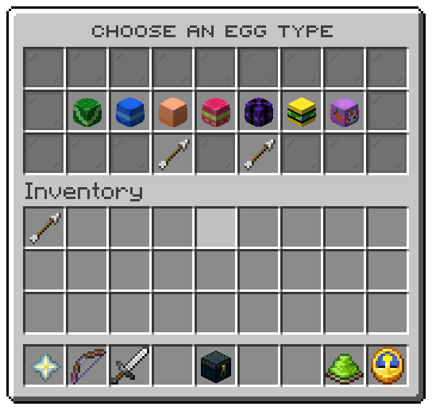

`/uxmeastereggs create` with no type, while you look at a block, opens this window. File: `menus/picker.conf`.

## The slots

| Slots | Item | Shows | Left click |
|---|---|---|---|
| 10 to 16, 19 to 25, 28 to 34, 37 to 43 | The type's head | The type's name | Places an egg of that type on the block |
| 10 | Barrier | *No type yet*, while `types/` holds none | nothing |
| 48 | Arrow | Previous page | turns back |
| 50 | Arrow | Next page | turns on |

The block is the one you looked at when you typed the command. Turning round while the window is open does not change
it, and the reply in chat names the position.

## The values

| Token | Value |
|---|---|
| `%pick_type%`, `%pick_id%`, `%pick_icon%` | The type's name, file name and head |
| `%pick_position%` | Its place in the list, used as the tile's colour |

| Action | Does |
|---|---|
| `eggs:place` | Places one egg of the clicked type |

| Condition | True while |
|---|---|
| `eggs:no-types` | The server has no egg type |

Related: [Types](../hunting/types.md), [Operator commands](../commands/admin.md#placing-eggs)
