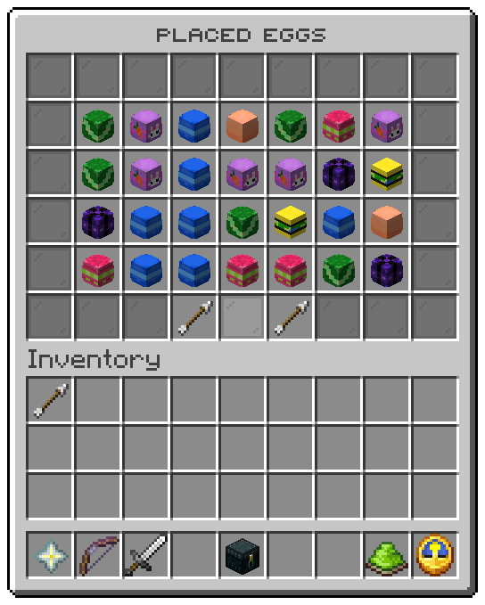

`/uxmeastereggs editor` opens the list of every placed egg. File: `menus/admin.conf`.

## The slots

| Slots | Item | Shows | Left click | Shift left click |
|---|---|---|---|---|
| 10 to 16, 19 to 25, 28 to 34, 37 to 43 | The egg's type head | The type, the short id and the position | Teleports you on top of the egg | Removes the egg and every find of it |
| 10 | Barrier | *No egg yet*, while the map has none | nothing | |
| 48 | Arrow | Previous page | turns back | |
| 50 | Arrow | Next page | turns on | |

<Callout type="danger" title="Shift left click removes at once">

There is no confirmation. The egg is taken off the map and every player loses their find of it. The block stays
where it is.

</Callout>

The buttons do not check `admin.tp` or `admin.delete` again: an operator who can open the window can do both.

## The values

| Token | Value |
|---|---|
| `%egg_type%`, `%egg_id%`, `%egg_icon%` | The type, the short id and the head |
| `%egg_position%`, `%egg_world%`, `%egg_x%`, `%egg_y%`, `%egg_z%` | Where it is |

| Action | Does |
|---|---|
| `eggs:teleport` | Goes to the egg that was clicked |
| `eggs:remove` | Takes it off the map, with its finds |

| Condition | True while |
|---|---|
| `eggs:no-eggs` | No egg stands on the map |

Related: [Operator commands](../commands/admin.md), [Eggs and finds](../hunting/overview.md)
