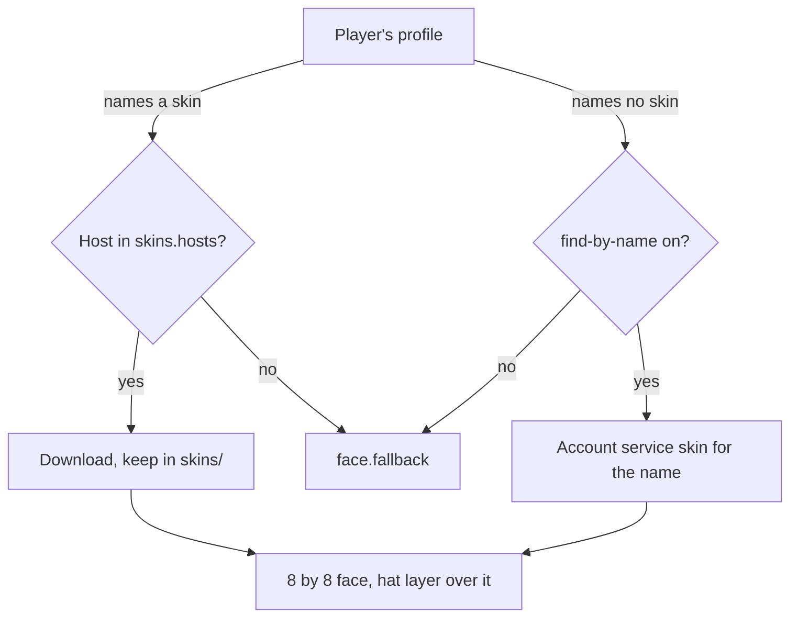

## Eight rows

A face is eight rows of eight characters, one row per chat line. Each character is one pixel, drawn in its colour with
`face.glyph`, a full block by default, which is as wide as a chat line is high, so the face comes out square. A line
draws a row with `<face:1>` to `<face:8>` in this plugin's messages, and with `%uxmheads_face_1%` to
`%uxmheads_face_8%` in any plugin that reads PlaceholderAPI. Words written after the row stand to its right.

## Where a face comes from

The address in a profile is set by the player's own client, so nothing is fetched from a host that is not listed, and
nothing that is not `http` or `https`.

## A player without a skin

A skin that cannot be read, and a player with no skin while `find-by-name` is off, wear `face.fallback` (Steve).
With an empty fallback such a player has no face: a row draws nothing, and the words of that line move to the left
edge.

## Memory and disk

Faces are held in memory, `skins.memory` (1000) of them; the faces of the players on the server are always among them.
Downloaded skins are files in `skins/`, read from disk next time. A file nobody wears for `skins.keep-days` (30) is
deleted; each join resets its days.

Related: [Faces and skins](../features/faces-and-skins.md)
