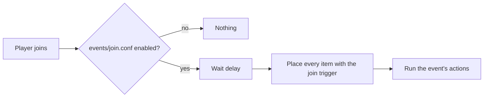

## Items

An item is one file under `items/`. The file name is its id: `items/selector.conf` is `selector`. Rename the file and
the id changes with it; there is no id written inside, so the two can never disagree. An id is lower-case letters,
digits, `-` and `_`.

## Triggers and events

An item's `triggers` say which moments hand it out: `join`, `first-join`, `respawn`, `world-change`. Each moment is also a
file under `events/` that can be switched off, delayed, and given actions to run once the items are in place.

## Where an item lands

The family rule for a held item: its `slot` when that is empty or already holds it, the slot the player moved it to, or
the first free slot. Another item is never written over, and the player holds one copy. With no room at all the item is
not given and nothing changes.

## Stamped items

Every item the plugin hands out carries a mark. `/uxmjoinitems clear` takes every marked item off a player wherever it
sits, and a locked item is recognised by its mark, not by its material, so a compass a player found is an ordinary
compass.

## Before an item is placed

| Check | Not given when |
|---|---|
| Online | The player left |
| Regions | The item names regions and the player is in none of them |
| Guards | A `skip-when` placeholder says the player is busy |
| Room | No slot is free |

Related: [Your first item](first-item.md), [Item files](../config/item-files.md)
