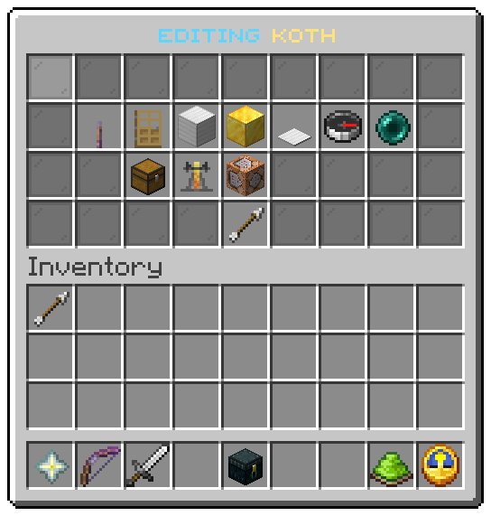

The editor opens on one arena from `/uxmkotl edit <arena>`, `/uxmkotl create <arena>`, or a click in the
[arena list](list.md). Every button writes the arena file at once and draws the window again, so there is no save
button. File: `menus/editor.conf`.

While the editor is open, the box of the arena is outlined in particles for you alone. See
[Arenas](../arenas/overview.md#the-outline).

## The buttons

| Slot | Item | Shows | Left click | Right click |
|---|---|---|---|---|
| 10 | Lever, glowing while on | *Now On*, *Now Off*, or *Still to set* with the missing pieces | Switches the arena on or off. Switching on is refused, with what is missing, until the arena is complete | |
| 11 | Oak door | Whether walking in joins | Turns `join-on-enter` over | |
| 12 | Iron block | Corner one, or *not set* | Moves it to the block your feet are in | Marks it by clicking a block |
| 13 | Gold block | Corner two | The same | The same |
| 14 | Heavy pressure plate | The plate | The same | The same |
| 15 | Compass | The spawn | Moves it to where you stand, facing where you look | |
| 16 | Ender pearl | The exit | The same | |
| 20 | Chest | Whether the inventory is cleared on entry | Turns `clear-inventory` over | |
| 21 | Brewing stand | Whether effects are cleared on entry | Turns `clear-effects` over | |
| 22 | Command block | The game mode | The next mode: survival, creative, adventure, spectator, and round again | |
| 31 | Arrow | *Back* | Opens the [arena list](list.md) | |

A place shows the block it stands in, rounded to the nearest block. A block or the spawn set in another world moves
the whole arena there and drops the pieces of the old world, as with [`set`](../commands/admin.md#set).

## Marking by clicking a block

A right click on a corner or the plate closes the window and asks you to click a block. The next block you left or
right click becomes the piece: the click does not break it or use it. The window then opens again with the piece
filled in. To give up, swing at the air (a left click at nothing). Quitting also drops the question.

The prompt line `arena.mark.prompt` of the shipped messages says *Type cancel to stop*; typing does nothing, the
swing at the air is what cancels.

## The values

| Token | Value |
|---|---|
| `%arena%` | The arena's display name |
| `%state%`, `%arena_state%`, `%missing%`, `%enabled%` | As in the [arena list](list.md#the-values) |
| `%enter%`, `%inventory%`, `%effects%` | On or off, as words |
| `%mode%` | The game mode |
| `%corner1%`, `%corner2%`, `%plate%`, `%spawn%`, `%exit%` | Where the piece is, or the words for a piece that is not set |
| `%corner1_state%` and the same for each piece | `set` or `unset`: which block of the messages the tile is read from |

| Action | Does |
|---|---|
| `kotl:toggle:state` | Switches the arena on or off |
| `kotl:toggle:enter`, `kotl:toggle:inventory`, `kotl:toggle:effects` | Turns a switch over |
| `kotl:next-mode` | Moves to the next game mode |
| `kotl:set-block:<piece>` | Moves `corner1`, `corner2` or `plate` to the block you stand in |
| `kotl:mark-block:<piece>` | Closes the window and waits for you to click a block |
| `kotl:set-point:<piece>` | Moves `spawn` or `exit` to where you stand |
| `kotl:list` | Goes back to the arena list |

Related: [Arena list](list.md), [Your first arena](../getting-started/first-arena.md), [Operator commands](../commands/admin.md)
