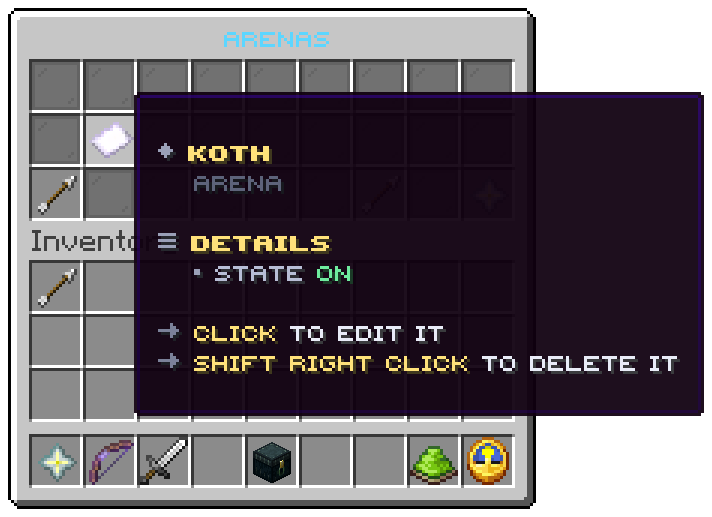

`/uxmkotl list`, or `/uxmkotl` alone, opens this window for an operator while at least one arena exists. Every arena
is listed, open, shut or half built. File: `menus/list.conf`.

## The slots

| Slots | Item | Shows | Left click | Shift right click |
|---|---|---|---|---|
| 10 to 16 | Paper, glowing while the arena is on | The arena's display name and its state: *On*, *Off*, or *Still to set* with the missing pieces | Opens the [editor](editor.md) on it | Deletes it |
| 18 | Arrow | Previous page | turns back | |
| 24 | Arrow | Next page | turns on | |
| 26 | Nether star | *New arena* | Asks for a name in an anvil, creates the arena and opens the editor | |

Seven arenas fit on a page; the arrows turn the pages and do nothing when there is no other page.

<Callout type="danger" title="Shift right click deletes at once">

There is no confirmation. The arena and its file are gone, unless a player is inside it, in which case the window
refuses with `error.arena-in-use`. Deleting an arena does not touch the records or the boards.

</Callout>

## The values

| Token | Value |
|---|---|
| `%arena%` | The arena's display name |
| `%state%` | On, off, or what it still needs, as words |
| `%arena_state%` | `on`, `off` or `incomplete`: which block of `menu.list.arena` the tile is read from |
| `%missing%` | The pieces still to set |
| `%enabled%` | `true` while the arena is on, for `decor.glow` |

| Action | Does |
|---|---|
| `kotl:edit` | Opens the editor on the arena of the tile |
| `kotl:delete` | Deletes that arena, unless somebody is inside |
| `kotl:create` | Asks for a name and creates an arena in the clicker's world |
| `kotl:list` | Opens this window again |

Related: [Arena editor](editor.md), [Operator commands](../commands/admin.md)
