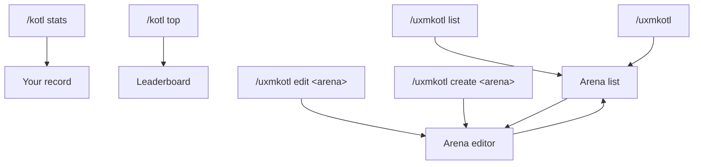

uxmKotl has four windows. Players see two of them; operators build arenas with the other two. Every window is a file
in `menus/`: see [Menu files](../config/menu-files.md) to change one.

## What opens what

| Command | Window | File | Permission |
|---|---|---|---|
| `/kotl stats` | [Your record](stats.md) | `menus/stats.conf` | `uxmkotl.play` |
| `/kotl top` | [Leaderboard](top.md) | `menus/top.conf` | `uxmkotl.play` |
| `/uxmkotl list`, `/uxmkotl` | [Arena list](list.md) | `menus/list.conf` | `uxmkotl.admin.list`, `uxmkotl.admin.version` |
| `/uxmkotl edit <arena>` | [Arena editor](editor.md) for that arena | `menus/editor.conf` | `uxmkotl.admin.edit` |
| `/uxmkotl create <arena>` | [Arena editor](editor.md) for the new arena | `menus/editor.conf` | `uxmkotl.admin.create` |

`list` opens the window only for a player and only when an arena exists; otherwise it answers in chat. The
clicks inside the operator windows do not check the nodes again: an operator who can open the list can edit and
delete from it.

## Typing a name

**New arena** in the list asks for a name in an anvil. Type it and take the result; close the anvil to go back to
the list. The rules of a name are those of `/uxmkotl create`: one to 32 lower-case letters, digits and `-`, starting
with a letter or a digit. The arena is created in the world you stand in, and the editor opens on it.

## Bedrock players

A player who joins through Geyser or Floodgate gets the same windows as Bedrock forms: a button per tile, in the
same order. Nothing needs setting up.

## Sounds

Every window plays the book page sound when it opens, from its own `open-actions`. Every button of the shipped files
plays its own note block sound, which takes the place of the shared click sound; the page arrows play the page sound,
and a refused click the denied sound. The three shared sounds are under `menu.sounds` in
[`config.conf`](../config/config-conf.md#menu) and are read again on reload. Filler panes are silent.

## Conventions

- **Left click does the plain thing.** A right click or a shift right click does the second thing, and the tooltip
  says which.
- **A glowing tile is a live one**: an arena that is on, in the list and on the editor's switch.
- **Words come from the messages files.** Every title, name and tooltip is a line of the
  [messages files](../config/messages.md) under `menu`, in the viewer's language. The tooltips are drawn in the house
  shape: a title, a crumb, a description, details and the click lines.

Related: [Menu files](../config/menu-files.md), [Your record](stats.md), [Arena editor](editor.md)
