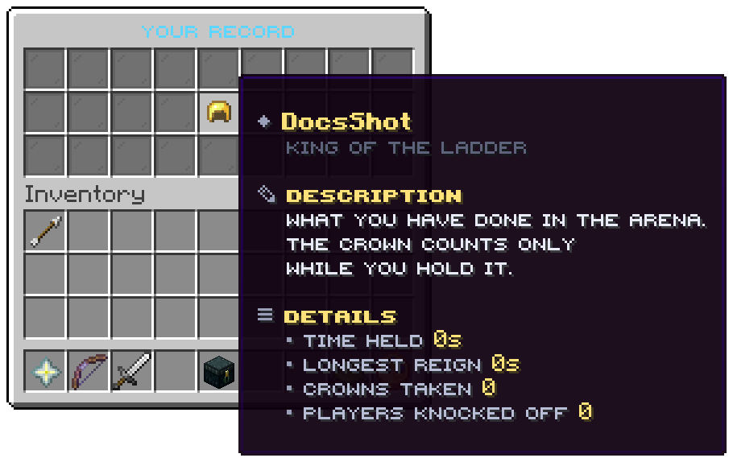

`/kotl stats` opens this window and writes the same record in chat in one line. It is three rows with one tile in
the middle. File: `menus/stats.conf`.

## The tile

| Slot | Item | Shows | Click |
|---|---|---|---|
| 13 | Golden helmet | Your name, then *Time held*, *Longest reign*, *Crowns taken* and *Players knocked off* | nothing |

The figures are the ones described in [Concepts](../getting-started/concepts.md#the-record): they cover every arena
and all time. A reign you are in now is added when it ends, so the window does not count it yet.

## The values

`menus/stats.conf` can write these into a line of its own:

| Token | Value |
|---|---|
| `%player%` | The player's name |
| `%held%` | Total time held, such as `4m 12s` |
| `%longest%` | The longest single reign |
| `%claims%` | Crowns taken |
| `%kills%` | Players knocked off |

The shipped tile is one lore line: `tile:header @menu.stats.record held longest claims kills`. Take a word off the end
to drop that fact from the tile; the words are in `menu.stats.record` of the messages files.

Related: [Player commands](../commands/player.md#records-and-boards), [Leaderboard](top.md)
