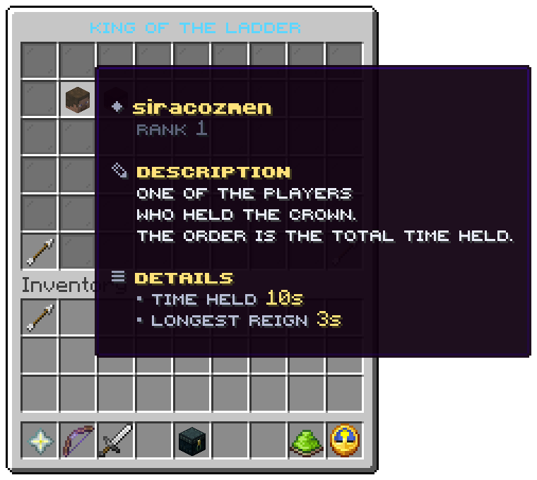

`/kotl top` with no board opens this window for a player. It ranks every player by total time held, all time,
across every arena. File: `menus/top.conf`.

## The slots

| Slots | Item | Shows | Click |
|---|---|---|---|
| 10 to 16, 19 to 25, 28 to 34 | A player head | Name, *Rank n*, *Time held*, *Longest reign* | nothing |
| 22 | A head | *Nobody yet*, while no player has ever held the crown | nothing |
| 45 | Arrow | Previous page | turns back |
| 53 | Arrow | Next page | turns on |

The list holds `menu.top.size` players, 10 by default and at most 54, so the shipped 21 slots fit them on one page.
The arrows are always drawn and do nothing when there is no other page. The window reads the record each player has,
so it changes the moment a reign ends; the boards that `/kotl top <board>` and the placeholders read change at the
next `leaderboard.refresh-seconds`.

For another board or period, such as this week's kills, use `/kotl top kills weekly` in chat or the
[placeholders](../placeholders/reference.md).

## The values

| Token | Value |
|---|---|
| `%place%`, `%rank%` | The place, counted from 1 |
| `%player%` | The player's name |
| `%held%` | Total time held |
| `%longest%` | The longest single reign |

| Condition | True while |
|---|---|
| `kotl:nobody-yet` | No player has ever held the crown |

Related: [Player commands](../commands/player.md#records-and-boards), [Your record](stats.md)
