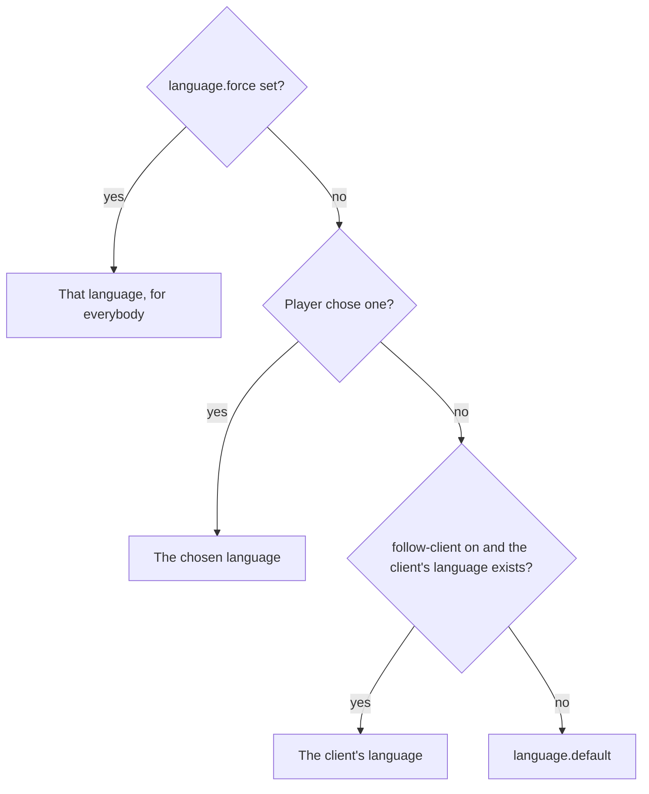

## Which language a player reads

The first that answers wins:

`/lang reset` drops a choice, so the player follows their client again.

## What a language is

A language exists because `messages/` holds a file for it: `messages_tr.conf` is Turkish. Write one more file and the
language exists; nothing lists them. `languages.conf` only names each one the way its readers write it, `Türkçe`
rather than `tr`, and gives it an icon.

## One choice for every plugin

uxmLang registers the language service uxmLib reads. Every UXM plugin asks that service which language a player
reads, so a choice made in `/lang` is the language of every UXM plugin. A plugin's own `/<plugin> lang set` writes to
the same choice while uxmLang is installed. Without uxmLang, each plugin keeps its own choice in its own
`languages.conf`.

A plugin draws a line in the chosen language when it has a file for it; a plugin without that file falls back to its
own default.

## One choice for every server

The choice is a row in the database, read while the player logs in, which is before the first line they read is
drawn. Every server pointed at the same database knows it. With Redis, a change is also published at once, so a
server the player is already on switches without waiting for the next login. See
[A network](../features/network.md).

Related: [Choosing a language](../features/choosing.md), [config.conf](../config/config-conf.md#language)
