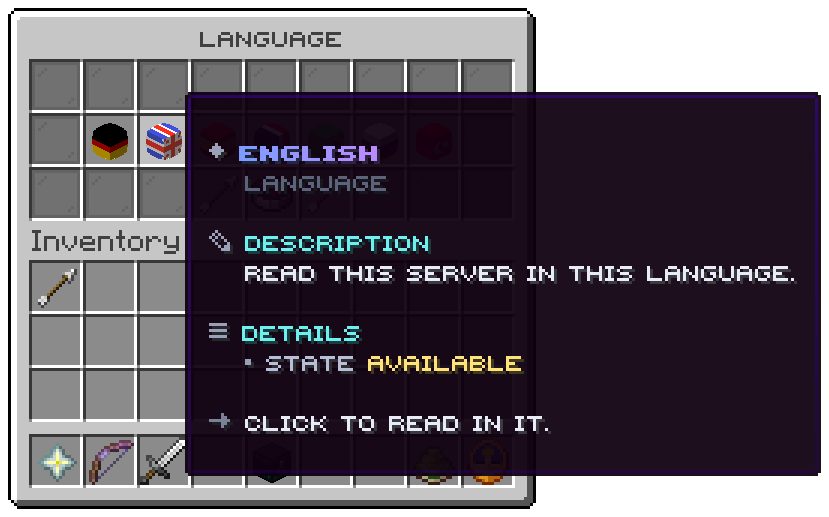

`/lang`, node `uxmlang.use`. Three rows.

| Slot | Holds | Click |
|---|---|---|
| 10 to 16 | One head per language, its flag from `languages.conf`, named as its readers write it, with its state | Reads the server in it |
| 18 | An arrow | The previous page |
| 22 | A compass: "Follow my client" | Drops the choice and follows the client |
| 26 | An arrow | The next page |

A language reads `Reading now` when it is the one the viewer reads and `Available` otherwise. Seven slots hold one
page; an eighth language goes to a second page. A Bedrock player gets the window as a form.

The picture is the lobby's, which moved the arrows next to the compass.

Delete `menus/language.conf` and the window is gone: `/lang` answers in chat with the lines of `/lang list`.

Related: [Menu file](../config/menu-files.md), [languages.conf](../config/languages-conf.md)
