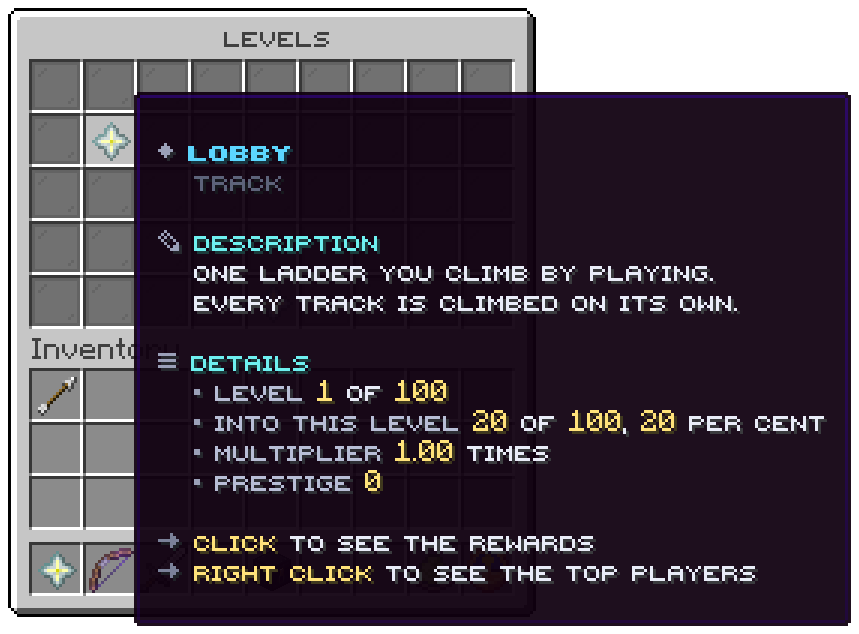

`/levels` opens this window: five rows, one tile per track.

The screenshot is from a lobby with one track of its own; the tables below describe the shipped
`menus/main.conf`.

## Slots

| Slot | Tile | Click |
|---|---|---|
| 10 to 16, 19 to 25 | One track each, in file name order, its `icon` | Left: the track's [rewards](rewards.md). Right: its [top players](top.md) |
| 40 | Nether star, `menu.button.prestige` | Opens the [prestige window](prestige.md) |
| Every other slot | Grey pane | Nothing |

The window has no page arrows, so it shows the first 14 tracks.

## A track

| Line | From |
|---|---|
| Title | The track's `display-name`, in a colour of the wheel by its place |
| Crumb | `menu.track.crumb`: `Track` |
| Description | `menu.track.description` |
| Level | `Level 3 of 100` |
| Into this level | `52 of 195, 26 per cent` |
| Multiplier | `1.25 times`: the product of the four multipliers |
| Prestige | The count and the badge |
| Click lines | `Click to see the rewards`, `Right click to see the top players` |

Related: [Rewards](rewards.md), [Top players](top.md), [Prestige](prestige.md)
