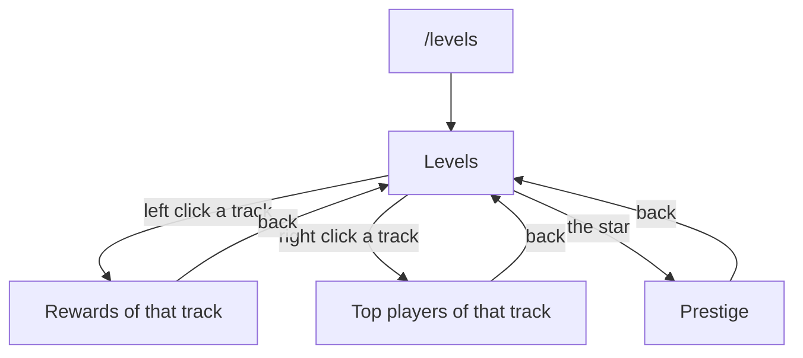

uxmLevels has four windows. Every window is a file in `menus/`: see [Menu files](../config/menu-files.md) to change
one. A window file you delete is written back at the next start.

| Window | File | Opened by |
|---|---|---|
| [Levels](main.md) | `menus/main.conf` | `/levels` (`uxmlevels.use`) |
| [Rewards](rewards.md) | `menus/rewards.conf` | Left click on a track |
| [Prestige](prestige.md) | `menus/prestige.conf` | The star in the levels window |
| [Top players](top.md) | `menus/top.conf` | Right click on a track |

The three inner windows check no node of their own: a player who can open `/levels` can claim rewards, see the boards
and prestige from them.

## Bedrock players

A player who joins through Geyser or Floodgate gets the same windows as Bedrock forms: a button per tile, in the
same order. Nothing needs setting up.

## Sounds

Every window plays the book page sound when it opens, from its own `open-actions`. Every button of the shipped files
plays its own pling, which takes the place of the shared click sound; the page arrows play the page sound, and a
refused click the denied sound. The three shared sounds are under `menu.sounds` in
[`config.conf`](../config/config-conf.md#menu) and are read again on reload.

## Conventions

- **Left click does the plain thing.** On a track, a right click is the second thing, and the tooltip says which.
- **A glowing tile is a live one**: a reward taken, a track ready to prestige.
- **Words come from the messages files.** Every tooltip is a line of the [messages files](../config/messages.md) under
  `menu`, drawn in the house shape: a title, a crumb, a description, details and the click lines.

Related: [Menu files](../config/menu-files.md), [Levels](main.md)
