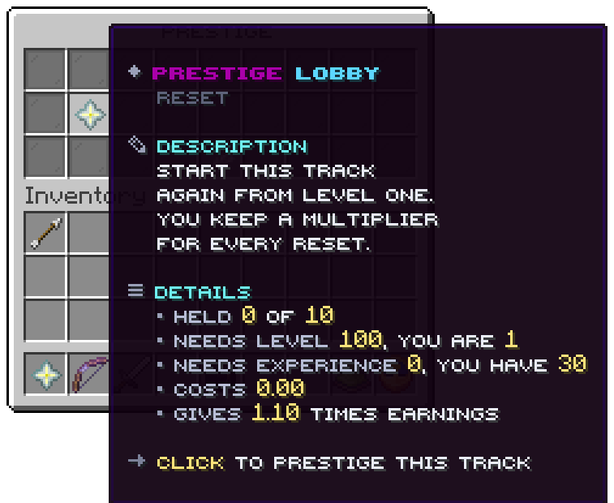

The star in the levels window opens this window: three rows, one tile per track.

## Slots

| Slot | Tile | Click |
|---|---|---|
| 10 to 16 | One track each; glowing when it can be prestiged now | Left click prestiges that track |
| 22 | Feather, `menu.button.back` | Back to the levels window |
| Every other slot | Grey pane | Nothing |

## A track

| Line | From |
|---|---|
| Title | `menu.prestige.tile.title`: `Prestige <track>` |
| Crumb | `Reset` |
| Description | `Start this track again from level one. You keep a multiplier for every reset.` |
| Held | `0 of 10`: the count and `prestige.maximum` |
| Needs level | `100, you are 64` |
| Needs experience | `prestige.experience-cost`, and what the player holds |
| Costs | `prestige.money-cost` |
| Gives | The multiplier the next prestige gives, such as `1.10 times earnings` |
| Click line | `Click to prestige this track` |

A click prestiges at once, with no second question, and answers as `/levels prestige` does. The window checks no
node; see [Prestige](../tracks/prestige.md#where-a-player-prestiges).

Related: [Prestige](../tracks/prestige.md), [Levels](main.md)
