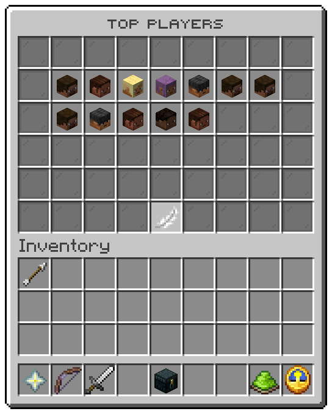

A right click on a track opens its top players, all time: six rows, a head per place.

## Slots

| Slot | Tile | Click |
|---|---|---|
| 10 to 16, 19 to 25, 28 to 34, 37 to 43 | One player each, their head, by place | Nothing |
| 10 | A barrier, `menu.top.empty`, when nobody has earned on the track | Nothing |
| 49 | Feather, `menu.button.back` | Back to the levels window |
| Every other slot | Grey pane | Nothing |

The window shows the first 28 places of the snapshot, read every `leaderboard.refresh-seconds`.

## A player

| Line | From |
|---|---|
| Title | The player's name |
| Crumb | `Rank <position>` |
| Description | `menu.top.tile.description` |
| Level | `12 of 100` |
| Experience | Their experience on the track |
| Prestige | Their prestige count |

Related: [Boards](../tracks/boards.md), [Levels](main.md)
