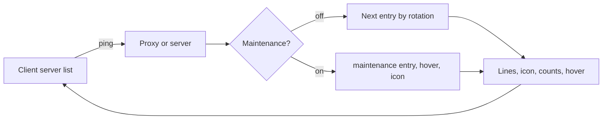

## The ping

A client that shows a server in its list sends a ping. The answer carries the description (two lines), the icon, the
online and maximum counts, a list of names for the hover, and a protocol version and name. uxmMOTD builds every part of
that answer.

## Entries

An entry is two lines and an optional icon. `motd.entries` is a list of them and `motd.rotation` picks one per ping.
Maintenance has one entry of its own.

## Roles, not colours

A line names a role such as `<value>`, `<good>` or `<accent>`; the colour behind each role is in `theme.conf`. One edit
there repaints every line of every UXM plugin.

## Two platforms

| | Paper | Velocity |
|---|---|---|
| Answers | Pings to this server | Pings to the whole network |
| Maintenance gate | At login, before the player exists | At login on the proxy |
| Bypass permission | Not available: only the exempt lists | `uxmmotd.maintenance.bypass` |
| Kick screen language | The server's default language | The player's |
| Permissions | Declared with defaults | No defaults: the console may run everything, a player needs the node |

## Languages

The server list entry is your own writing in `config.conf`, in whatever language you write it. The message files hold
the command replies and the maintenance kick screen.

Related: [Your first entry](first-entry.md), [Entries](../features/entries.md)
