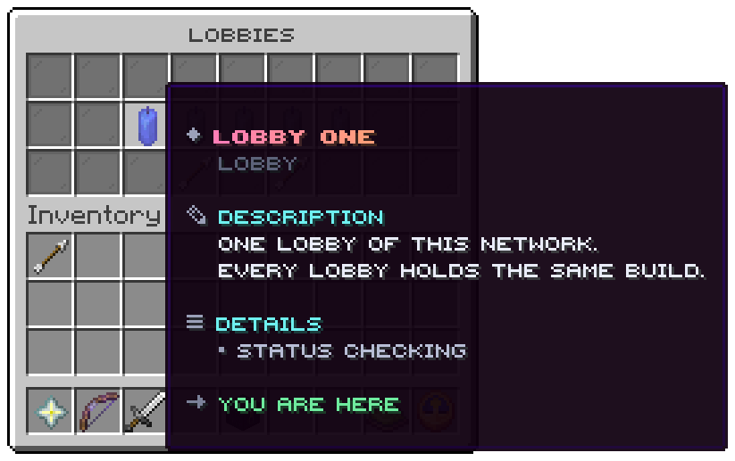

`/lobby` or the hotbar tool, node `uxmmultilobby.use`. Three rows.

| Slot | Holds | Click |
|---|---|---|
| 10 to 16 | One icon per lobby, at the `slot` its block names; the lobby you are on glows | Joins it, or says why not |
| 21 | An arrow | The previous page |
| 23 | An arrow | The next page |

The shipped five lobbies sit in 11 to 15, the middle of the row.

## A lobby's tooltip

| Part | Shows |
|---|---|
| Title | The lobby's name, in its `colour` |
| Players | `<players> of <maximum>`; left out for a lobby that has told nothing yet |
| Status | Online, Full, Offline, or Checking before the first answer |
| The closing line | `Click to join it`, `You are here`, `You may not join this lobby`, `This lobby is full`, `This lobby is not answering` or `Waiting for the first answer` |

The picture is from a development lobby with one server running, so the others are still checking, and it colours
lobbies by load.

## Colouring by load

The shipped window draws each lobby with its own `icon`. Write `material = "%lobby_load_icon%"` in
`menus/lobbies.conf` to colour every lobby by how full it is instead:

| Load | When | Material (`menu.load-icons`) |
|---|---|---|
| `current` | The lobby the player is on | `BLUE_CANDLE` |
| `open` | It answered and has room | `LIME_CANDLE` |
| `busy` | It holds at least `menu.busy-at-percent` (50) of its maximum | `YELLOW_CANDLE` |
| `full` | It is at its maximum | `RED_CANDLE` |
| `closed` | Offline, or not heard from since the server started | `GRAY_CANDLE` |

`%lobby_load%` is the word itself, for a lore line.

## Locked lobbies

A lobby with a `permission` the player lacks is shown locked. `menu.hide-locked = true` leaves it out instead: shown
locked advertises what a rank buys, left out keeps a staff lobby unseen.

## The best-lobby button

The file carries a commented `best` button for slot 22 that runs `lobby:best`, the same as `/quicklobby`. Take the
hashes off to switch it on.

Related: [Menu file](../config/menu-files.md), [Live counts](../features/live-counts.md)
