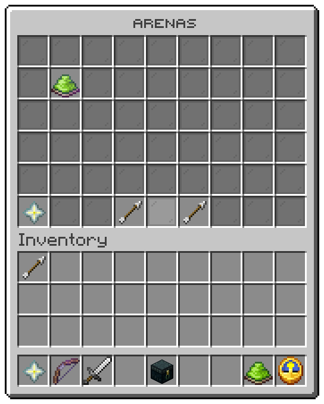

Opened by `/uxmparkour edit` with no arena, by `/uxmparkour list`, or by the bare `/uxmparkour`, and by **Back** in
the editor. Layout: `menus/arenas.conf`, six rows.

| Slot | Tile | Click |
|---|---|---|
| 10 to 16, 19 to 25, 28 to 34 | One tile per arena | Left: opens its [editor](editor.md). Shift right: deletes it |
| 45 | **New arena**, a nether star | Left: asks for a name in an anvil, then opens the editor on the new arena |
| 48 | Previous page | Turns the page; does nothing on the first page |
| 50 | Next page | Turns the page; does nothing on the last page |
| every other slot | Grey glass filler | nothing |

## An arena's tile

| State | Icon | Title colour | Glows |
|---|---|---|---|
| Open | Lime dye | `good` | yes |
| Shut | Grey dye | `muted` | no |
| Incomplete | Barrier | `warn`; the tooltip lists the pieces still to set | no |

The icons and colours are the `placeholders` block at the top of the file, so a server can change them without
touching a tile. A colour is a role of [theme.conf](../config/theme.md) or a place on its colour wheel written as a
number.

<Callout type="warning" title="Shift right click deletes at once">

Deleting from the list asks nothing, ends every run on the server first, and removes the arena from `arenas.conf`.
There is no undo except a copy of the file.

</Callout>

## Tokens

| Token | Value |
|---|---|
| `%arena%` | The arena's name |
| `%arena_icon%` | The `icon-<state>` line for its state |
| `%arena_role%` | The `role-<state>` line for its state |
| `%arena_open%` | `true` when players may join it |
| `%tile_arena%` | The tooltip of an arena |
| `%tile_create%` | The tooltip of **New arena** |

## Actions

| Action | Does |
|---|---|
| `parkour:edit-arena` | Opens the editor of the clicked arena |
| `parkour:delete-arena` | Deletes the clicked arena, ending every run first |
| `parkour:new-arena` | Asks for a name and opens the editor on the new arena |

Related: [Arena editor](editor.md), [Operator commands](../commands/admin.md), [Arenas](../arenas/overview.md)
