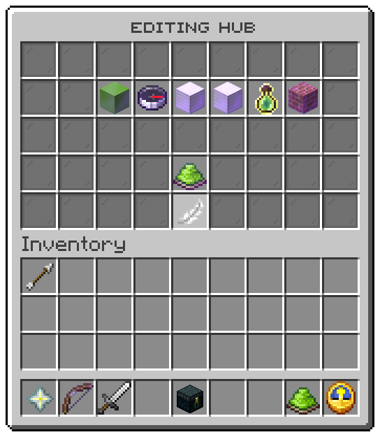

Opened by `/uxmparkour edit <arena>`, by `/uxmparkour create <name>`, and from the [arena list](arenas.md). Layout:
`menus/arena-editor.conf`, five rows. The title names the arena.

| Slot | Tile | Left click | Right click |
|---|---|---|---|
| 11 | **Start block**, lime concrete | Takes the block under your feet | Closes the window; the next block you click becomes the start |
| 12 | **Heading**, a compass | Takes the way you face, rounded to north, east, south or west | the same |
| 13 | **Corner one**, an iron block | Takes the block under your feet | Closes the window; the next block you click becomes the corner |
| 14 | **Corner two**, an iron block | Takes the block under your feet | Closes the window; the next block you click becomes the corner |
| 15 | **Difficulty**, a bottle o' enchanting | Steps to the next difficulty in `config.conf` | the same |
| 16 | **Palette**, bricks | Steps to the next theme in `config.conf` | the same |
| 31 | **Open to players**, a dye or a barrier | Opens the arena, or shuts it | |
| 40 | **Back**, a feather | Opens the [arena list](arenas.md) | |
| every other slot | Grey glass filler | | |

Each piece's tooltip shows what it holds now, or **not set**, and a set piece glows. After every click the editor
opens again with the row filled in.

## Marking a block from a distance

A right click on a position row closes the window and waits for one block. Left or right click any block in reach
and it becomes that piece; the click is cancelled, so the block is not broken. Swinging at the air instead cancels
the question and says so. Either way the editor opens again.

A block in another world than the arena's moves the arena to that world and drops its other positions, because a
box spans one world.

## The switch

| Arena | Switch | Click |
|---|---|---|
| Open | Lime dye, glowing | Shuts it, which ends every run on the server first |
| Shut, every piece set | Grey dye | Opens it, unless the start block is outside the box |
| A piece missing | Barrier, "Set every piece first" | Refused, naming the missing pieces |

## Tokens

| Token | Value |
|---|---|
| `%editor_title%` | The window title, naming the arena |
| `%piece%` | The piece in the row: `start`, `heading`, `corner1`, `corner2`, `difficulty`, `theme` |
| `%piece_icon%` | The `icon-<piece>` line |
| `%piece_set%` | `true` once the piece is set |
| `%tile_piece%` | The tooltip of a piece |
| `%arena_icon%`, `%arena_role%`, `%arena_open%` | The switch's look by the arena's state, as in the [list](arenas.md) |
| `%tile_toggle%` | The tooltip of the switch |
| `%tile_back%` | The tooltip of **Back** |

## Actions

| Action | Does |
|---|---|
| `parkour:set-piece` | Takes where you stand, the way you look, or the next value |
| `parkour:pick-piece` | Closes the window and waits for a block |
| `parkour:toggle-arena` | Opens the arena or shuts it |

The six rows are laid into slots 11 to 16 in the order above; move the `pieces` slots to move all six. Swap
`left` and `right` in the file to make clicking a block the plain action.

Related: [Your first arena](../getting-started/first-arena.md), [Arenas](../arenas/overview.md),
[Operator commands](../commands/admin.md)
