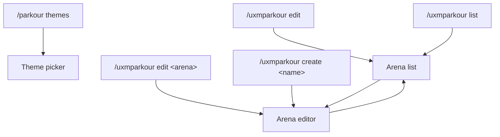

uxmParkour has three windows. Players see one; operators build arenas with the other two. Every window is a file in
`menus/`: see [Menu files](../config/menu-files.md) to change one.

## What opens what

| Command | Window | Permission |
|---|---|---|
| `/parkour themes` | [Theme picker](themes.md) | `uxmparkour.play` |
| `/uxmparkour edit`, `/uxmparkour list`, `/uxmparkour` | [Arena list](arenas.md) | `uxmparkour.admin.edit`, `uxmparkour.admin.list` |
| `/uxmparkour edit <arena>` | [Arena editor](editor.md) for that arena | `uxmparkour.admin.edit` |
| `/uxmparkour create <name>` | [Arena editor](editor.md) for the new arena | `uxmparkour.admin.create` |

`list` opens the list only for a player and only when an arena exists; otherwise it answers in chat.

## Typing a name

**New arena** in the list asks for a name in an anvil. Type it and take the result; close the anvil to go back to
the list. The rules of a name are the same as for `/uxmparkour create`: one to 32 lower-case letters, digits, `_` or
`-`.

## Bedrock players

A player who joins through Geyser or Floodgate gets the same windows as Bedrock forms: a button per tile, in the
same order. Nothing needs setting up.

## Sounds

Every window plays the book page sound when it opens. The click, page-turn and refusal sounds are the three under
`menu.sounds` in [`config.conf`](../config/config-conf.md#menu), read again on reload; a button whose own actions
play a sound plays that sound alone. Filler panes are silent.

## Conventions

- **Left click does the plain thing.** A right click or a shift right click does the second thing, and the tooltip
  says which.
- **A glowing tile is the current one**: the theme you build with, an open arena, a piece that is set.
- **Words come from the messages files.** Every title, name and tooltip is a line of the
  [messages files](../config/messages.md), in the viewer's language. The tooltips are drawn in the house shape: a
  title, a crumb, a description, details and the click line.

Related: [Menu files](../config/menu-files.md), [Theme picker](themes.md), [Arena editor](editor.md)
