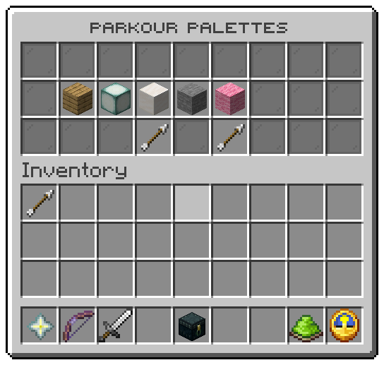

Opened by `/parkour themes`. Layout: `menus/themes.conf`, three rows.

| Slot | Tile | Click |
|---|---|---|
| 10 to 16 | One tile per theme in `config.conf`, in the order written, drawn with its `icon` | Left: builds your runs from that theme and closes the window, with a pling |
| 21 | Previous page | Turns the page; does nothing on the first page |
| 23 | Next page | Turns the page; does nothing on the last page |
| every other slot | Grey glass filler | nothing |

The theme you build with glows and its tooltip says **In use**; the others say **Ready**. The choice is the same as
`/parkour theme <theme>` and starts with your next run. The words are under `menu.theme` in the messages files: the
crumb, the description, the state and the click line.

## Tokens

| Token | Value |
|---|---|
| `%theme%` | The theme's id |
| `%theme_icon%` | Its `icon` from `config.conf` |
| `%theme_worn%` | `true` on the theme the viewer builds with |
| `%tile_theme%` | The whole tooltip, in the viewer's language |

## Actions

| Action | Does |
|---|---|
| `parkour:choose-theme` | Chooses the clicked theme |

Replace `%tile_theme%` with lore lines of your own and the plugin draws those instead. See
[Menu files](../config/menu-files.md) for every key a window file takes.

Related: [Themes](../arenas/themes.md), [Player commands](../commands/player.md)
