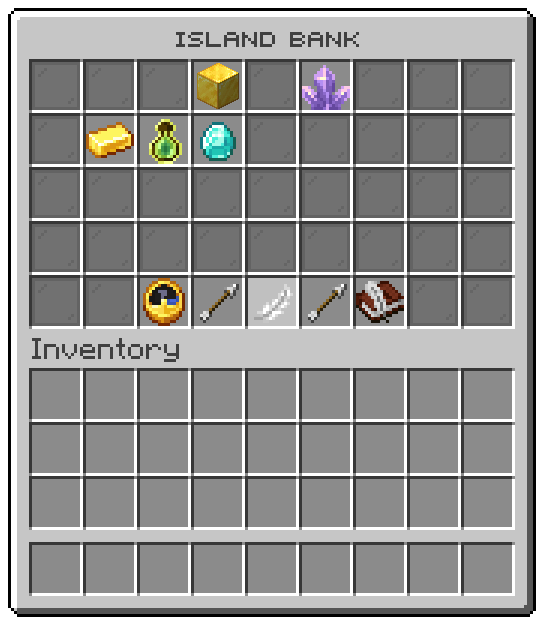
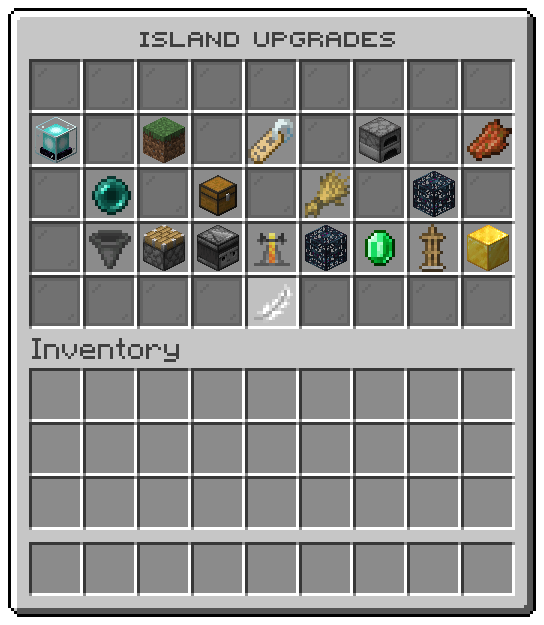

## Bank

The file is `menus/island-bank.conf`. The window is titled "Island bank" and has 5 rows.
The island bank, the window the bank tile of the island menu opens.

| Slot | Item | What it shows | Click |
|---|---|---|---|
| 3 | `GOLD_BLOCK` | Island bank: The bank every member of your island shares. Click a currency to put some in or take some out. |  |
| 5 | `AMETHYST_CLUSTER` | Island resources: What missions earn the island. Nobody puts them in or takes them out. |  |
| 10-16, 19-25 | `%entry_icon%` | One tile for each entry. Kept in the island bank for every member. | opens that currency |
| 39 | `ARROW` | ← Previous page |  |
| 38 | `CLOCK` | Upkeep: What your island owes each day, and what happens when the bank cannot pay. | runs `/is bank upkeep` |
| 40 | `FEATHER` | « Back | opens the [island menu window](island.md#island-menu) |
| 42 | `WRITABLE_BOOK` | Island activity: Every move of the bank, and everything else that happened on the island. | runs `/is activity` |
| 39 | `ARROW` | ← No page before this one |  |
| 41 | `ARROW` | → Next page |  |
| 41 | `ARROW` | → No page after this one |  |

## Bank currency

The file is `menus/island-bank-currency.conf`. The window is titled "" and has 4 rows.
One currency of the island bank, the window its tile in the bank window opens.

| Slot | Item | What it shows | Click |
|---|---|---|---|
| 2 | `LIME_DYE` | Put in: Moves from you into the island bank. | puts that amount in |
| 3 | `LIME_DYE` | Put in: Moves from you into the island bank. | puts that amount in |
| 5 | `HOPPER` | Put in an amount: Moves as much as you write from you into the island bank. | asks you to type, puts that amount in |
| 6 | `CHEST` | Put in all: Moves everything you carry of it into the island bank. | puts that amount in |
| 13 | `%argument_currency_icon%` | What the island bank holds of it, and what you carry. |  |
| 20 | `RED_DYE` | Take out: Moves from the island bank to you. | takes that amount out |
| 21 | `RED_DYE` | Take out: Moves from the island bank to you. | takes that amount out |
| 23 | `DROPPER` | Take out an amount: Moves as much as you write from the island bank to you. | asks you to type, takes that amount out |
| 24 | `BARREL` | Take out all: Moves everything the island bank holds of it to you. | takes that amount out |
| 31 | `FEATHER` | « Back | runs `/is bank` |

## Upgrades

The file is `menus/island-upgrades.conf`. The window is titled "Island upgrades" and has 5 rows.
The island upgrades, the window the upgrades tile of the island menu opens.

| Slot | Item | What it shows | Click |
|---|---|---|---|
| 11 | `GRASS_BLOCK` | Island size: Widens the border, so your island has room to grow. | buys the next tier |
| 9 | `BEACON` | Island effects: Potion effects the members wear while on the island. | buys the next tier |
| 17 | `ROTTEN_FLESH` | Mob drops: Mobs killed on your island drop more. | buys the next tier |
| 13 | `NAME_TAG` | Team size: Lets more players belong to your island. | buys the next tier |
| 15 | `FURNACE` | Ore generator: A cobblestone generator that turns up richer ores. Now: . Next tier: . | buys the next tier |
| 19 | `ENDER_PEARL` | Warp slots: Lets your island open more warps to visitors. | buys the next tier |
| 21 | `CHEST` | Vault pages: Adds a page to the vault every member shares. | buys the next tier |
| 23 | `WHEAT` | Crop growth: Makes the crops of your island grow faster. | buys the next tier |
| 25 | `SPAWNER` | Spawner rates: Makes the spawners of your island work faster. | buys the next tier |
| 28 | `HOPPER` | Hopper limit: Lets your island hold more hoppers. | buys the next tier |
| 29 | `PISTON` | Piston limit: Lets your island hold more pistons and sticky pistons. | buys the next tier |
| 30 | `OBSERVER` | Redstone limit: Lets your island hold more observers, droppers and dispensers. | buys the next tier |
| 31 | `BREWING_STAND` | Brewing limit: Lets your island hold more brewing stands. | buys the next tier |
| 32 | `SPAWNER` | Spawner limit: Lets your island hold more spawners. | buys the next tier |
| 33 | `EMERALD` | Villager limit: Lets more villagers live on your island. | buys the next tier |
| 34 | `ARMOR_STAND` | Entity limit: Lets your island hold more armour stands, minecarts and boats. | buys the next tier |
| 35 | `GOLD_BLOCK` | Bank limit: Lets the island bank hold more money. | buys the next tier |
| 40 | `FEATHER` | « Back | opens the [island menu window](island.md#island-menu) |

## Shop

The file is `menus/island-shop.conf`. The window is titled "Island shop" and has 6 rows.
The island shop: buy with the island bank, or sell into it.

| Slot | Item | What it shows | Click |
|---|---|---|---|
| 10-16, 19-25, 28-34 | `%entry_material%` | One tile for each entry. Bought with the island bank, and sold into it. | Left: buys; Right: sells; Shift left: buys; Shift right: sells |
| 48 | `ARROW` | ← Previous page |  |
| 48 | `ARROW` | ← No page before this one |  |
| 49 | `FEATHER` | « Back | opens the [island menu window](island.md#island-menu) |
| 50 | `ARROW` | → Next page |  |
| 50 | `ARROW` | → No page after this one |  |

## Vault

The file is `menus/island-vault.conf`. The window is titled "Island vault" and has 4 rows.
The island vault, the window the vault tile of the island menu opens.

| Slot | Item | What it shows | Click |
|---|---|---|---|
| 11 | `CHEST` | Page 1: A chest every member of your island shares. | runs `/is vault 1` |
| 12 | `CHEST` | Page 2: A chest every member of your island shares. | runs `/is vault 2` |
| 12 | `IRON_BARS` | Page 2: Your island has not bought this page yet. A vault upgrade adds one. | opens the [upgrades window](#upgrades) |
| 13 | `CHEST` | Page 3: A chest every member of your island shares. | runs `/is vault 3` |
| 13 | `IRON_BARS` | Page 3: Your island has not bought this page yet. A vault upgrade adds one. | opens the [upgrades window](#upgrades) |
| 14 | `CHEST` | Page 4: A chest every member of your island shares. | runs `/is vault 4` |
| 14 | `IRON_BARS` | Page 4: Your island has not bought this page yet. A vault upgrade adds one. | opens the [upgrades window](#upgrades) |
| 15 | `ENDER_CHEST` | More pages: Buy another page among the upgrades. | opens the [upgrades window](#upgrades) |
| 31 | `FEATHER` | « Back | opens the [island menu window](island.md#island-menu) |

## Vault page

The file is `menus/island-vault-page.conf`. The window is titled "Island vault, page" and has 6 rows.
One page of the island vault, the chest every member of the island shares.

| Slot | Item | What it shows | Click |
|---|---|---|---|
| 49 | `FEATHER` | « Back | opens the [vault window](#vault) |
| 48 | `ARROW` | ← Previous page | opens that vault page |
| 48 | `ARROW` | ← No page before this one |  |
| 45 | `CHEST` | Page: Every member of your island shares these pages. Your role decides what you can move. |  |
| 50 | `ARROW` | → Next page | opens that vault page |
| 50 | `ARROW` | → No page after this one |  |

## Missions

The file is `menus/island-missions.conf`. The window is titled "Missions" and has 3 rows.
The missions of the island, the window the missions tile of the island menu opens.

| Slot | Item | What it shows | Click |
|---|---|---|---|
| 10 | `CLOCK` | Daily missions: They start again every day. The rewards are small, and they add up. | runs `/is missions daily` |
| 12 | `BOOK` | Weekly missions: Harder than the daily ones, and worth more. | runs `/is missions weekly` |
| 14 | `NETHER_STAR` | Challenges: Goals you finish once, for a reward you get once. | runs `/is challenges` |
| 16 | `CHEST_MINECART` | Claim rewards: Everything you have earned and not collected yet. | runs `/is rewards claim` |
| 22 | `FEATHER` | « Back | opens the [island menu window](island.md#island-menu) |

## Mission list

The file is `menus/island-mission-list.conf`. The window is titled "Missions" and has 6 rows.
The missions of the island, one tile each.

| Slot | Item | What it shows | Click |
|---|---|---|---|
| 10-16, 19-25, 28-34, 37-43 | `%entry_material%` | One tile for each entry.  | hands the mission in |
| 48 | `ARROW` | ← Previous page |  |
| 48 | `ARROW` | ← No page before this one |  |
| 49 | `FEATHER` | « Back | opens the [missions window](#missions) |
| 50 | `ARROW` | → Next page |  |
| 50 | `ARROW` | → No page after this one |  |

## Boosters

The file is `menus/island-booster-cards.conf`. The window is titled "Island boosters" and has 4 rows.
The boosters running on the island, one card for each kind: the window the boosters tile of the island menu and /is booster open.

| Slot | Item | What it shows | Click |
|---|---|---|---|
| 4 | `NETHER_STAR` | Island multipliers: Booster timers freeze while no member is online. |  |
| 10, 12, 14, 16, 21, 23 | `%entry_material%` | One tile for each entry. booster: A booster raises this rate for your whole island while it runs. |  |
| 31 | `FEATHER` | « Back | opens the [island menu window](island.md#island-menu) |

## Leaderboards

The file is `menus/island-top.conf`. The window is titled "Leaderboards" and has 3 rows.
The leaderboards, the window the leaderboards tile of the island menu opens.

| Slot | Item | What it shows | Click |
|---|---|---|---|
| 10 | `EXPERIENCE_BOTTLE` | By level: The highest island levels on this server. | runs `/is top level` |
| 12 | `DIAMOND` | By worth: The islands worth the most, counted block by block. | runs `/is top worth` |
| 14 | `GOLD_INGOT` | By bank: The richest island banks. | runs `/is top bank` |
| 16 | `SPYGLASS` | Where you stand: Where your island stands, and what one more place would take. | runs `/is level` |
| 22 | `FEATHER` | « Back | opens the [island menu window](island.md#island-menu) |

## Leaderboard

The file is `menus/island-leaderboard.conf`. The window is titled "Top islands" and has 5 rows.
A leaderboard: the window each board of the top menu and /is top `<board>` open.

| Slot | Item | What it shows | Click |
|---|---|---|---|
| 4 | `NETHER_STAR` | Top islands by: Where your own island stands on this board. |  |
| 11-15, 20-24 | `%entry_head%` | One tile for each entry. #: An island on this board, and whose it is. | visits the island |
| 40 | `FEATHER` | « Back | opens the [leaderboards window](#leaderboards) |

## Block values

The file is `menus/block-values.conf`. The window is titled "Block values" and has 6 rows.
Block values: what each block adds to an island, the most points first.

| Slot | Item | What it shows | Click |
|---|---|---|---|
| 10-16, 19-25, 28-34, 37-43 | `%entry_material%` | One tile for each entry. What one of these adds to an island. |  |
| 48 | `ARROW` | ← Previous page |  |
| 48 | `ARROW` | ← No page before this one |  |
| 50 | `ARROW` | → Next page |  |
| 50 | `ARROW` | → No page after this one |  |
