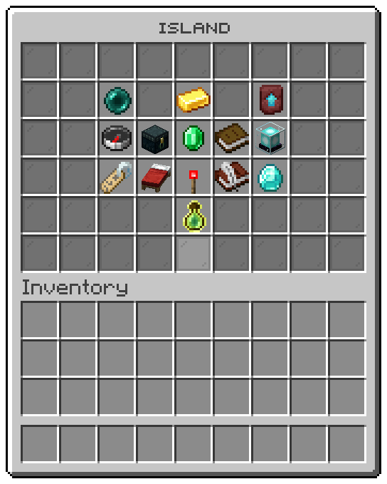
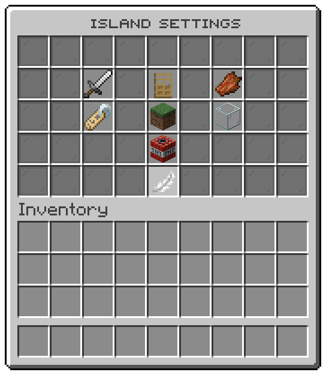
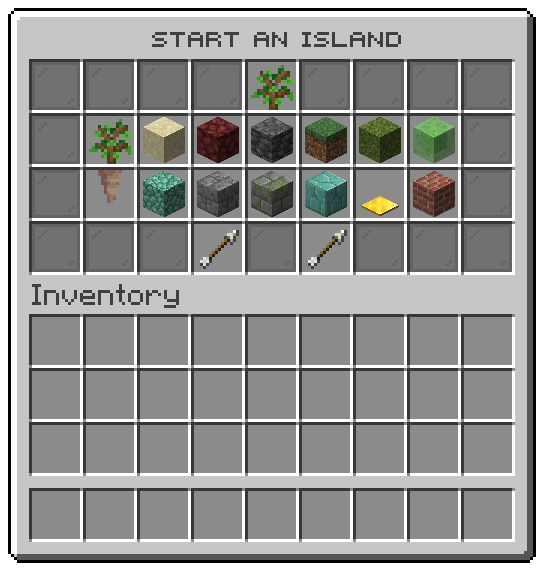

## Island menu

The file is `menus/island-main.conf`. The window is titled "Island" and has 6 rows.
The island menu, the window /is opens.

| Slot | Item | What it shows | Click |
|---|---|---|---|
| 11 | `ENDER_PEARL` | Go home: Takes you to the spawn of your island. | takes you to your island |
| 13 | `GOLD_INGOT` | Island bank: The money every member shares, and the crystals your island earned. | opens the [bank window](economy.md#bank) |
| 15 | `NETHERITE_UPGRADE_SMITHING_TEMPLATE` | Upgrades: Make the island bigger, the team larger and the generator richer. | opens the [upgrades window](economy.md#upgrades) |
| 20 | `COMPASS` | Warps: The places your island opens to visitors. | opens the [warps window](travel.md#warps) |
| 21 | `ENDER_CHEST` | Vault: A chest every member of your island shares. | opens the [vault window](economy.md#vault) |
| 22 | `EMERALD` | Island shop: Buy with the island bank, or sell into it. | opens the island shop |
| 23 | `BOOK` | Missions: Goals for your island, and the rewards waiting at the end of them. | opens the [missions window](economy.md#missions) |
| 24 | `BEACON` | Boosters: Faster spawners, crops and experience, for a while. | runs `/is booster` |
| 29 | `NAME_TAG` | Members: Who belongs to your island, and what each of them may do. | opens the [members window](team.md#members) |
| 30 | `RED_BED` | Homes: The places you marked on your island, and where it begins. | opens the [homes window](travel.md#homes) |
| 31 | `REDSTONE_TORCH` | Settings: Choose what visitors may do and what may happen on your island. | opens the [settings window](#settings) |
| 32 | `WRITABLE_BOOK` | Social: Guestbook, ratings, alliances, and what happened while you were away. | opens the [social window](travel.md#social) |
| 33 | `DIAMOND` | Leaderboards: Where your island stands against every other one on the server. | opens the [leaderboards window](economy.md#leaderboards) |
| 40 | `EXPERIENCE_BOTTLE` | Island level: How large your island is, and where it lies. | runs `/is level` |

## Settings

The file is `menus/island-settings.conf`. The window is titled "Island settings" and has 5 rows.
The settings of the island, the window the settings tile of the island menu opens.

| Slot | Item | What it shows | Click |
|---|---|---|---|
| 11 | `IRON_SWORD` | Fighting: Whether members and visitors may fight on your island. | runs `/is flag pvp` |
| 13 | `OAK_DOOR` | Visitors: Whether anyone who is not a member may come onto your island. | runs `/is flag locked` |
| 15 | `ROTTEN_FLESH` | Monster spawns: Whether monsters come out on your island. | runs `/is flag monster_spawn` |
| 20 | `NAME_TAG` | Rename the island: The name your island shows on the leaderboards. | asks you to type, runs `/is rename %input%` |
| 22 | `GRASS_BLOCK` | Biome: The weather, the colour of the grass and what grows on your island. | opens the [biomes window](#biomes) |
| 24 | `GLASS` | Border: The wall that marks where your island ends: whether you see it, and its colour. | runs `/is border` |
| 31 | `TNT` | Reset the island: Erases your island so you can start again. You are asked once more before it goes. | runs `/is reset` |
| 40 | `FEATHER` | « Back | opens the [island menu window](#island-menu) |

## Border

The file is `menus/island-border.conf`. The window is titled "Island border" and has 5 rows.
The island border: whether you see it, and the colour it is drawn in. /is border opens it, and so does the border tile of the settings window.

| Slot | Item | What it shows | Click |
|---|---|---|---|
| 10 | `ENDER_EYE` | Show or hide: The wall that marks where your island ends. Hide it, and it stays hidden on every island. | shows or hides the border |
| 12 | `LIGHT_BLUE_STAINED_GLASS` | Blue: The colour a border standing still is drawn in. | draws the border in that colour |
| 14 | `LIME_STAINED_GLASS` | Green: The colour of a border that grows. | draws the border in that colour |
| 16 | `RED_STAINED_GLASS` | Red: The colour of a border that closes in. | draws the border in that colour |
| 40 | `FEATHER` | « Back | opens the [settings window](#settings) |
| 28-34 | `%entry_material%` | One tile for each entry. How your island's edge is drawn, the same for everybody who comes. | draws the island edge that way |
| 39 | `ARROW` | ← Previous page |  |
| 39 | `ARROW` | ← No page before this one |  |
| 41 | `ARROW` | → Next page |  |
| 41 | `ARROW` | → No page after this one |  |

## Biomes

The file is `menus/island-biome.conf`. The window is titled "Island biome" and has 4 rows.
The biomes an island can take, the window the biome tile of the settings opens.

| Slot | Item | What it shows | Click |
|---|---|---|---|
| 10 | `GRASS_BLOCK` | Plains: The biome every island starts with. | runs `/is biome plains` |
| 11 | `SAND` | Desert: No rain falls, and cactus grows faster. | runs `/is biome desert` |
| 12 | `JUNGLE_LOG` | Jungle: Warm and wet, and cocoa grows here. | runs `/is biome jungle` |
| 13 | `LILY_PAD` | Swamp: Slimes come out at night. | runs `/is biome swamp` |
| 14 | `SNOW_BLOCK` | Snowy plains: Water freezes and snow settles. | runs `/is biome snowy_plains` |
| 15 | `POPPY` | Flower forest: Bees, and every flower there is. | runs `/is biome flower_forest` |
| 16 | `NETHERRACK` | Nether wastes: Water boils away and nether mobs come out. | runs `/is biome nether_wastes` |
| 31 | `FEATHER` | « Back | opens the [settings window](#settings) |

## Start an island

The file is `menus/island-create.conf`. The window is titled "Start an island" and has 4 rows.
The kinds of island a player can start, the window /is create and a player with no island open.

| Slot | Item | What it shows | Click |
|---|---|---|---|
| 4 | `OAK_SAPLING` | Start an island: Pick the kind of island you begin on. Each plays its own way. |  |
| 10-16, 19-25 | `%entry_icon%` | One tile for each entry.  | Left: starts that island; Right: shows a preview first |
| 30 | `ARROW` | ← Previous page |  |
| 30 | `ARROW` | ← No page before this one |  |
| 32 | `ARROW` | → Next page |  |
| 32 | `ARROW` | → No page after this one |  |

## Reset

The file is `menus/island-reset.conf`. The window is titled "Delete your island?" and has 3 rows.
The island reset: the last question before every block of the island is gone.

| Slot | Item | What it shows | Click |
|---|---|---|---|
| 11 | `RED_CONCRETE` | Delete: Your island and everything on it is gone for good: blocks, chests, items and the bank. It cannot be undone. | resets the island |
| 15 | `GREEN_CONCRETE` | Keep it: Nothing happens. Your island stays as it is. | keeps the island |
